# Magi

**Your local AI engineering team.**

Magi is a local-first, self-hostable AI engineering workspace. It puts goals, ownership, context, tools, changes, embedded browser, and verification into a single observable workflow, transforming complex software tasks from brittle "one-shot prompting" into sustained, reviewable, and verifiable engineering pipelines.

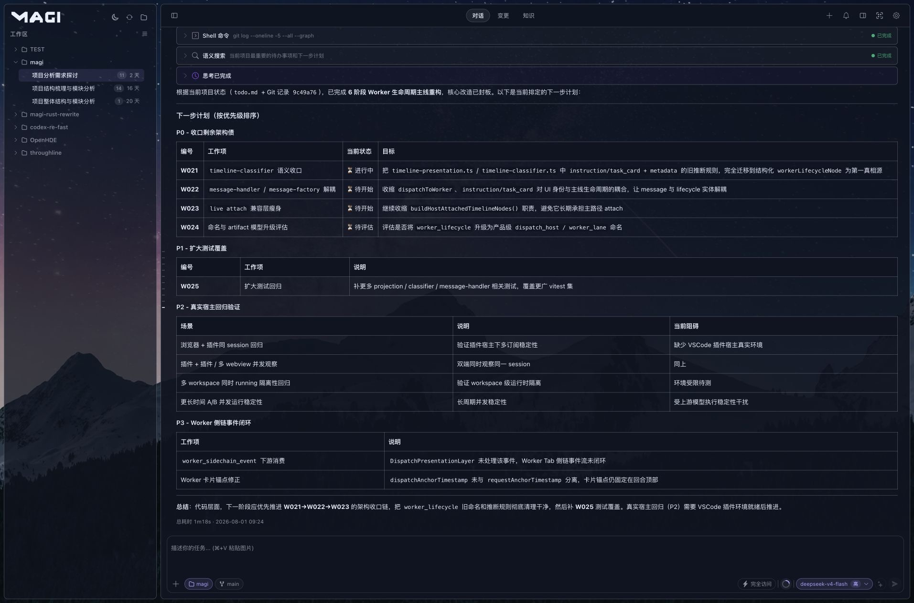

> **Turn a single request into a durable, observable, and reviewable engineering workflow.**

[中文](README.md) · [English](README.en.md) · [Architecture Graph](docs/architecture.html) · [License](LICENSE) · [GitHub](https://github.com/MistRipple/magi-code)

## English

### Complex engineering should not depend on repeated prompting

Behind any non-trivial code modification lies a chain of decisions: what outcome matters, where to start, who investigates, which model fits, which files change, how to verify, and where to recover after a failure. Magi organizes that chain into a long-running local engineering team:

- **Mainline first with specialist delegation**: The mainline agent owns the goal and drives implementation. When isolation is required, it delegates to specialized agents (executor, explorer, architect, tester, reviewer) with role-specific models.
- **Embedded Chromium browser & multi-purpose right pane**: Directly renders an authentic Electron `<webview>` inside Svelte content slots, enabling agent-driven page automation, DOM inspection, element highlighting, and real-time live review.
- **Extensible plugin ecosystem & standard MCP server**: One-click installation of sandboxed plugins and workflows. Magi not only consumes external MCP tools, but also exposes a standard MCP server for external clients.
- **Full lifecycle controllability**: Supports FIFO input queuing, dynamic steering mid-execution, and immediate "stop and redirect". Context pressure is monitored by a single authority with continuous lossless prefix compaction.
- **Rigorous security & governance**: File I/O, shell execution, background processes, Git worktree isolation, network access, and MCP tools run under unified sandbox rules and permission approval gates.

Magi is not another chat window with extra controls. It turns every request into an engineering pipeline that can run for hours, recover from crashes, and be reviewed end-to-end.

---

### From request to delivery

~~~text
Outcome / Goal submitted
   ↓
SessionTurnCoordinator accepts, queues, and enables dynamic steering
   ↓
Mainline agent analyzes constraints and drives the task (mainline-first by default)
   ↓
Structured delegation under strict contract (parallel work / review / context isolation)
   ↓
Governed execution across Files, Shell, Embedded Chromium, Search, Knowledge, MCP & Plugins
   ↓
Usage Authority evaluates context pressure in real-time and triggers continuous compaction
   ↓
Streaming output, task state, code diffs, and interactive approvals remain continuously visible
   ↓
Mainline synthesizes findings, validates changes, and ships the verified outcome
~~~

---

### Core capabilities

#### 1. Mainline-first with structured specialist delegation

The mainline agent acts as an engineering lead: understanding requirements, driving execution, and synthesizing outcomes. When independent sub-tasks arise, it delegates to specialized roles:

- **Executor**: Code implementation and tangible modifications.
- **Explorer**: Cross-directory code reading, call graph analysis, and impact assessment.
- **Architect**: Architectural trade-offs, system boundaries, and technical decisions.
- **Tester**: Test case design, automated verification, and regression gap analysis.
- **Reviewer**: Independent auditing for security, maintainability, and code quality.

**Strict delegation contract & topology constraints**:
- **Mainline-first by default**: Regular tasks such as inspecting functions, single-file edits, or running tests must be handled directly by the mainline without agent spawning overhead.
- **Structured decision contract**: Spawning an agent requires an explicit `delegation` justification with four bounded purposes: `user_requested`, `parallel_work`, `context_isolation`, and `independent_review`. Parallel work must explicitly describe the concurrent parent work.
- **Bounded nesting & settlement**: Supports at most two tiers of agents (parent $\to$ child $\to$ grandchild; deeper recursion is disabled by default). Cancellation executes deterministic resource cleanup and artifact collection, preventing leaked processes or unobserved side effects.

#### 2. Embedded Chromium browser & multi-purpose right pane

Magi seamlessly integrates a multi-purpose workbench pane with an authentic Chromium browser, eliminating laggy screenshots and fake coordinate projections:

- **Universal shell (`RightPane`)**: A unified container hosting code viewers, file diffs, terminal instances (xterm.js), agent execution cards, and browser tabs.
- **Authentic Chromium `<webview>`**: Direct Electron `<webview>` mounting in Svelte content slots ensures that user manual actions and agent CDP automation operate on the exact same physical DOM.
- **Authority & automation worker**: `magi-browser-authority` manages logical tab and surface leases; an independent Node.js automation worker provides precise DOM parsing, element highlighting, page snapshots, and browser actions.

#### 3. Extensible plugin system & official plugin center

Users can extend tools, user interfaces, and execution workflows without modifying Magi source code or rebuilding binaries:

- **Unified lifecycle**: Managed by `PluginManager`, offering verification, versioned resources, permission grants, activation, and safe uninstallation.
- **Isolated execution sandbox**: Plugins run in an isolated QuickJS Worker environment to safeguard host stability.
- **Deep UI integration**: Plugins can contribute settings tabs, workbench entries, and custom data panels rendered in isolated iframes inside the right pane.
- **Plugin Center**: Built-in official plugin center (`plugin-center`) for discovering and installing extensions; ships with a first-party GPT Web plugin wrapper.

#### 4. Dual MCP ecosystem (Client + Standard Server)

Magi delivers complete bidirectional interoperability for the Model Context Protocol (MCP):

- **MCP Client**: Connects seamlessly to local and remote MCP servers, incorporating third-party tools into agent context.
- **Magi MCP Server**: Built-in standard MCP server (`magi-mcp-server`) supporting **stdio**, **local loopback HTTP**, and **Cloudflare Quick Tunnel** remote access. External clients can securely inspect workspace files, perform symbol searches, and query Git diffs and change ledgers.

#### 5. Context pressure authority & continuous lossless compaction

Say goodbye to naive "head-and-tail stitching" or blunt truncation. Magi implements an industry-standard context architecture:

- **Single source of truth**: `magi-usage-authority` manages token metering, physically separating upcoming window prediction from cumulative billing (`billable_tokens`).
- **Continuous prefix summarization**: Compaction activates proactively before approaching the model context ceiling, summarizing a continuous time-range prefix.
- **Structural pairing guarantee**: **Tool calls and their corresponding tool results are strictly never separated across compaction boundaries**. Oversized outputs are pre-trimmed deterministically, and provider context-limit errors trigger bounded automatic recovery.

#### 6. Input queuing, dynamic steering & stop-and-redirect

- **Single-writer coordinator**: Each session is driven by an isolated `SessionTurnCoordinator` ensuring atomic, orderly state transitions.
- **FIFO input queue**: Messages sent while a run is in progress are queued reliably without requiring the user to wait for turn completion.
- **Dynamic steering**: Inject corrective instructions on the fly; the model perceives the guidance at the next step and adjusts course.
- **Stop & Redirect**: Instantly abort the current execution attempt and seamlessly switch to an entirely new objective.

#### 7. Goal mode & crash-safe durable recovery

- **Continuous Goal progression**: Objectives, constraints, acceptance criteria, task checklists, and progress are persisted durably; supports continuous execution, pausing, editing, and resumption.
- **Crash safety & side-effect prevention**: Interactive approvals (`tool_approvals`) and user questions (`user_questions`) are bound natively to tool items. Upon restart, pending interactions must be explicitly handled before continuing—no automatic replay of unverified side effects.

#### 8. Models configured by responsibility

Supports standard OpenAI-compatible endpoints and the Anthropic Messages protocol:

- **Main model**: Mainline conversation, decomposition, and global orchestration.
- **Auxiliary model**: Conversation titles, knowledge extraction, memory, and continuous compaction.
- **Image model**: Compatible Images API integration; generated assets are saved directly into the workspace.
- **Role models**: Independent model bindings for executor, explorer, architect, tester, and reviewer.

#### 9. Unified security & governance tool runtime

File manipulation, patch applications, symbol searches, shell commands, background daemons, Git actions, and knowledge retrieval are all governed under a single runtime:
- Workspace boundary enforcement and directory contention detection.
- Granular access profiles (read-only, restricted, full-access) with native approval flows for destructive operations.
- Change Ledger tracks every modified line, allowing users to review, revert, or merge branches prior to commit.

#### 10. Single instance, multi-client, and deep personalization

- **Single daemon core**: The desktop app starts and hosts `magi-daemon`. Closing the window minimizes to the system tray by default, keeping background tasks running.
- **Cross-platform**: Native builds for Windows, Linux, and macOS, alongside local-network and responsive mobile browser access.
- **Unified appearance engine**: Includes Follow System, Light, Dark, Deep Forest, Starry Snow Mountain, Azure Shrine, Quantum Matrix, Coastal Dawn, and Desert Dawn themes with wallpaper and material support.

---

### Product evidence

These captures come from the daemon-hosted local entry point using the `magi` and `magi-rust-rewrite` workspaces. The mainline, model, and appearance captures use sanitized demonstration data, while the change review shows real workspace changes as they appeared when the image was captured. They are complete application-window captures on the same `1913 × 1263` canvas.

#### From outcome to delivery

The mainline keeps goals, execution status, final findings, and the next input in a single unified view.

#### From division to execution

Requests can specify roles and responsibilities in the input area, allowing the mainline to partition complex work into independent, reviewable packages.

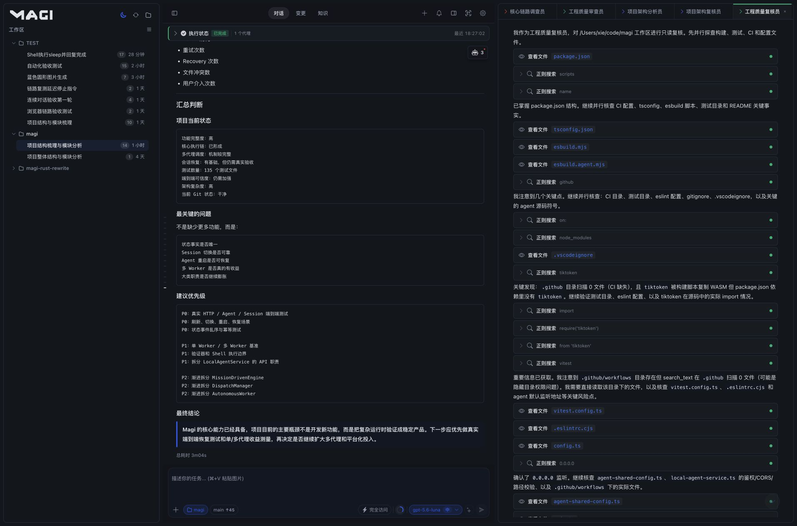

#### From models to roles

Independent model bindings for main, auxiliary, image, and specialist roles ensure model selection serves the task.

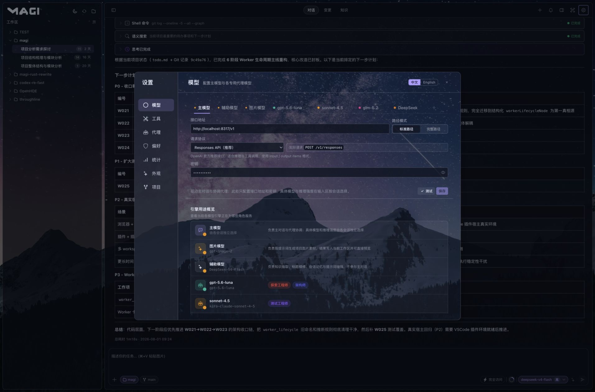

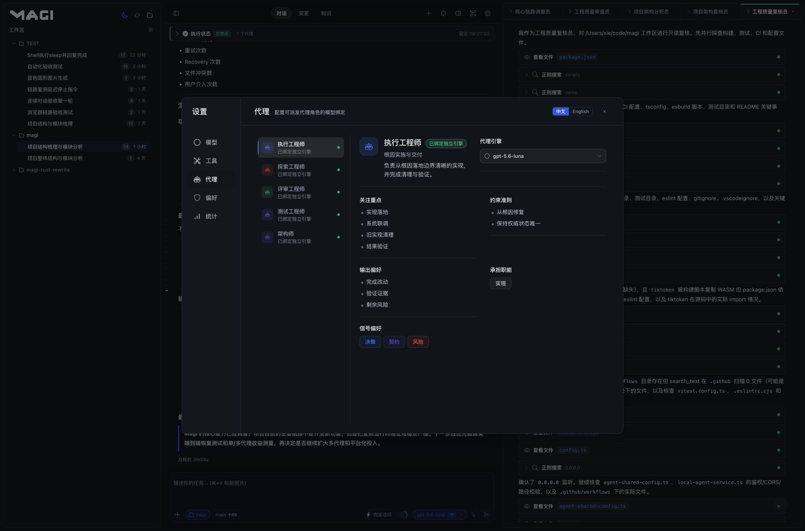

#### Themes and workspace materials

The theme library unifies color schemes, wallpapers, and workspace materials.

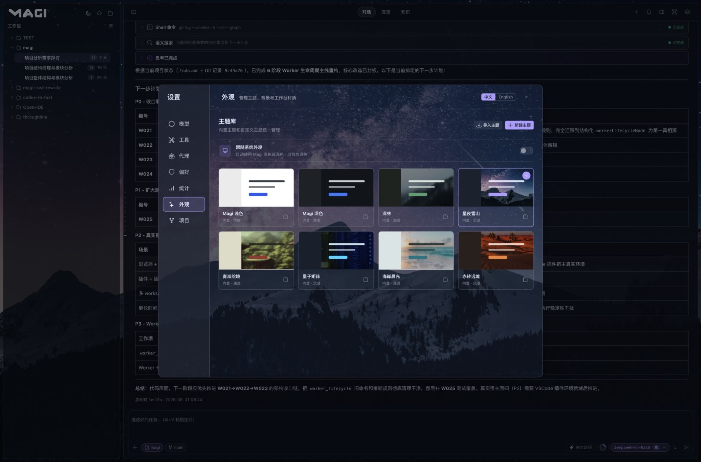

#### From tools to knowledge

Tools, MCP, Skills, ADRs, FAQs, and engineering insights remain visible in the workspace.

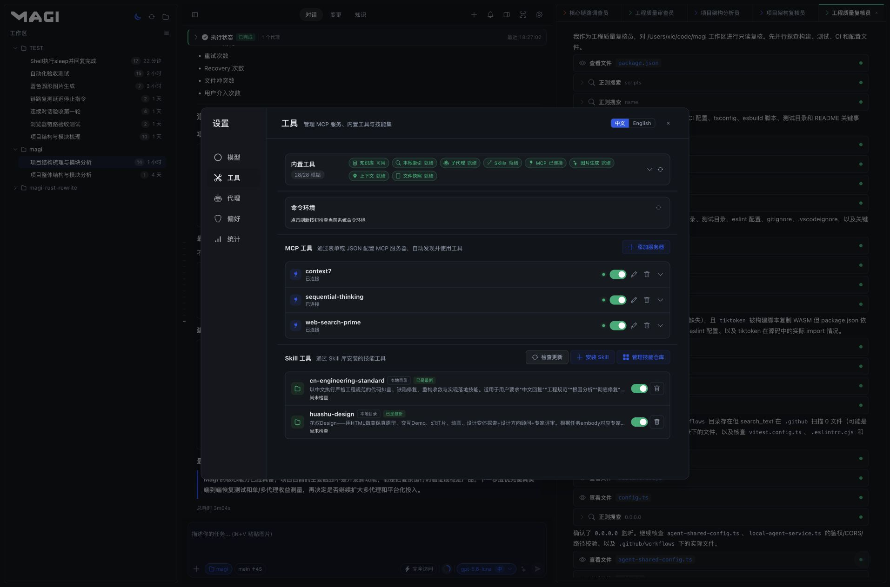

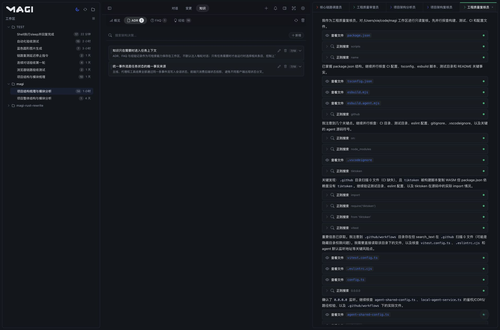

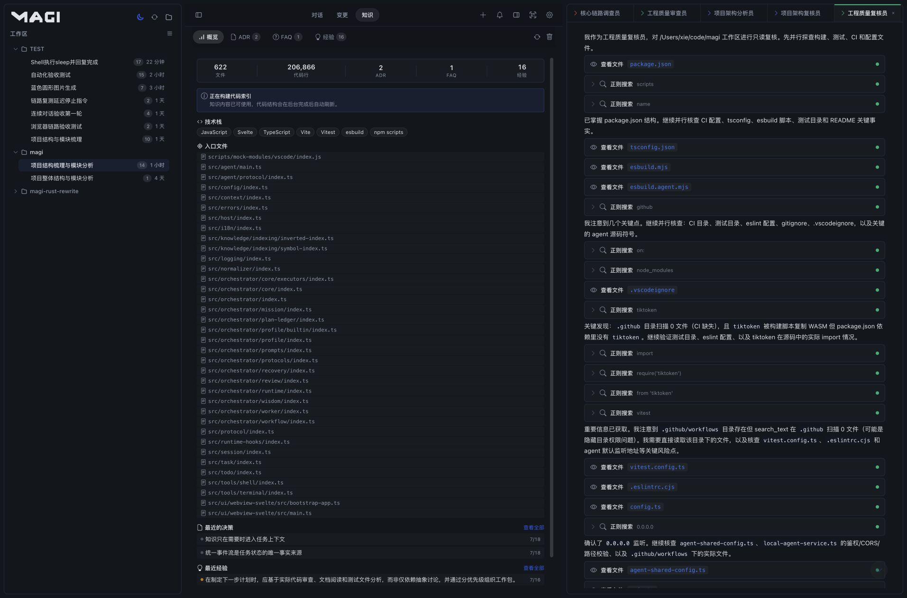

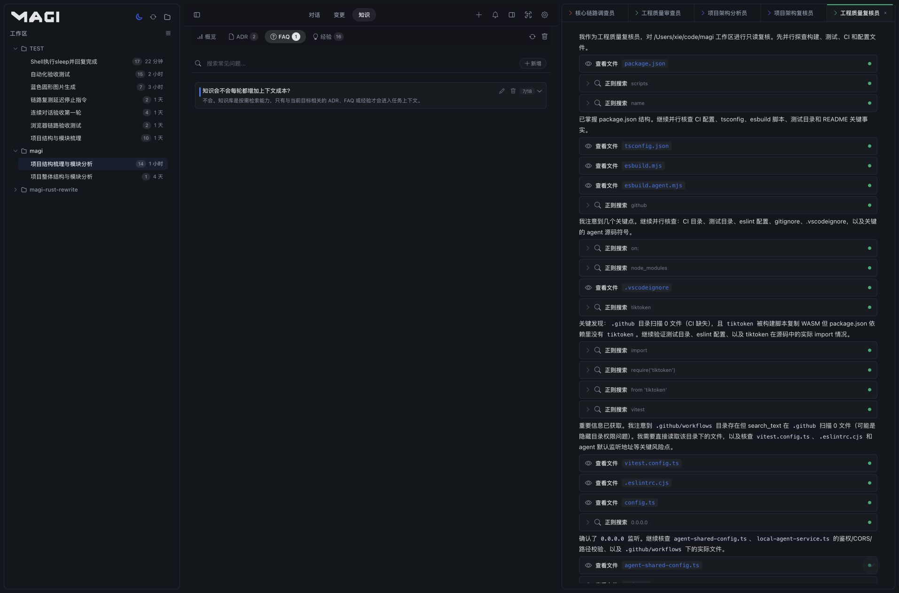

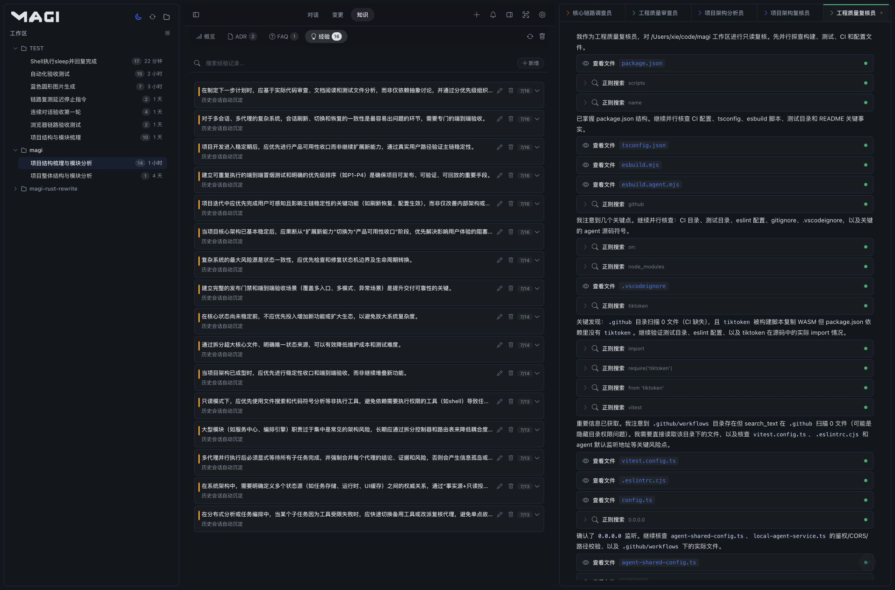

#### From changes to shipping

File attribution, line statistics, unified diffs, and tool outputs stay in an auditable ledger.

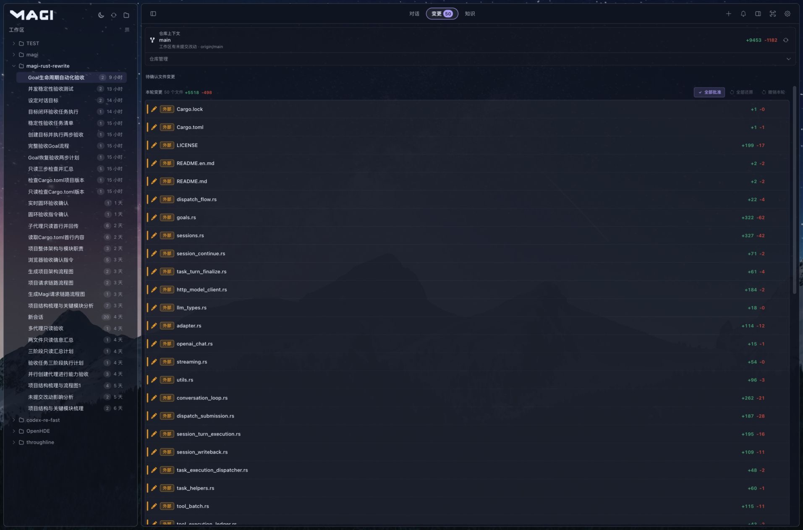

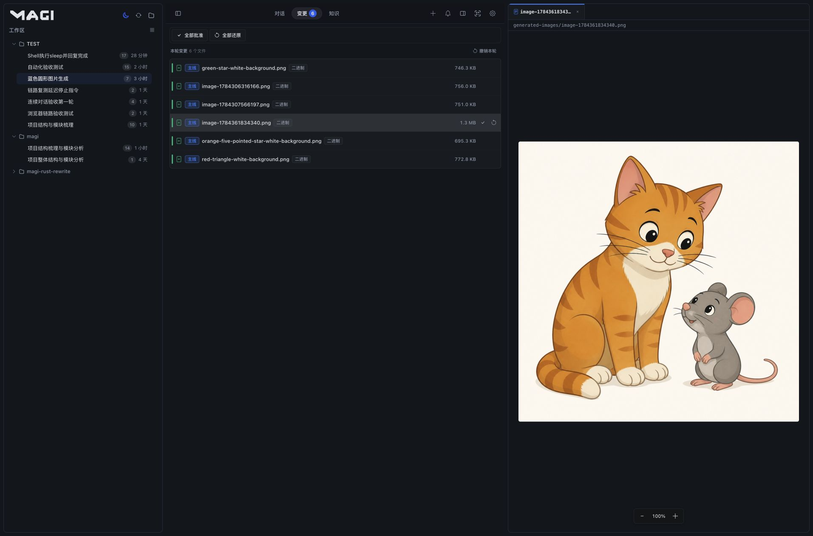

#### Image generation and token usage

Assets generated by image models land directly in the workspace; usage panels help inspect cost.

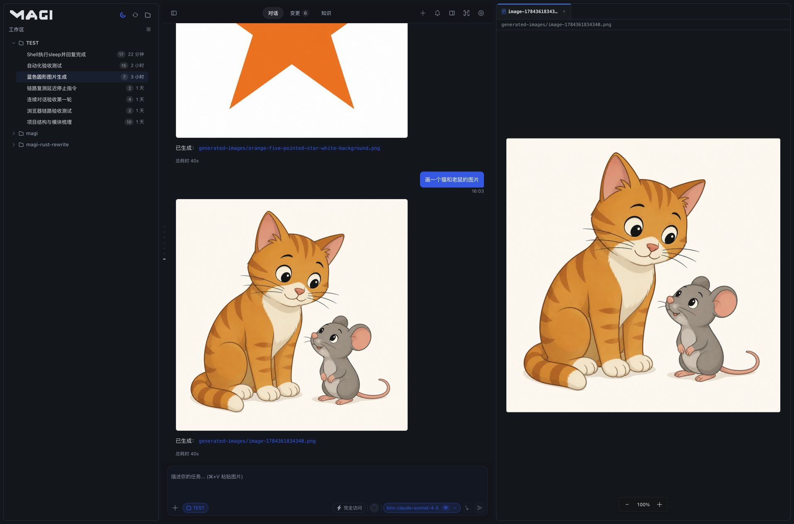

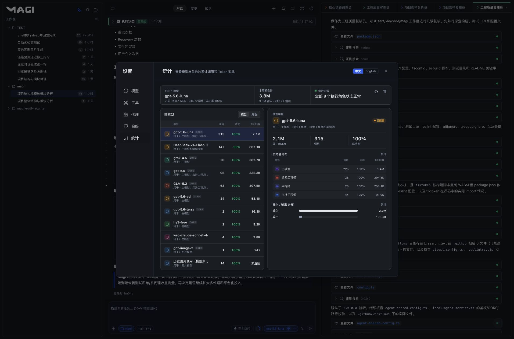

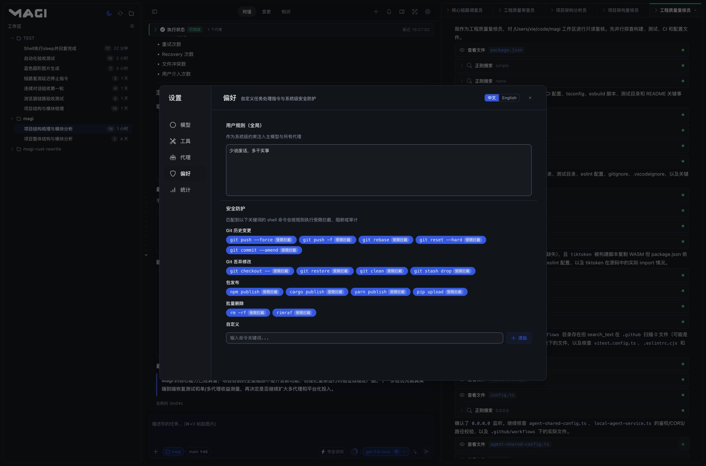

This sequence mirrors Magi's core engineering path: **Set Goal → Organize Roles → Execute & Verify → Review Changes → Capture Knowledge**.

---

### Why teams use Magi

Magi turns raw model intelligence into a local, durable, reviewable engineering system:

- **Bring your own model stack**: Independent configurations for mainline, auxiliary, image, and specialist roles.
- **Bounded multi-agent collaboration**: Mainline-first discipline, strict delegation contracts, and bounded two-tier topologies.
- **Full execution visibility**: Goals, tasks, agent lifecycles, tool calls, and diffs are tracked on one continuous timeline.
- **Accumulate institutional memory**: Code indexing, ADRs, FAQs, and engineering experience stay anchored to your local repo.
- **Unified tool & browser governance**: Files, shell, symbol search, embedded Chromium, and MCP share one sandbox and permission model.
- **Bidirectional extensibility**: Sandboxed QuickJS plugins plus an exposed standard MCP server.
- **User-owned runtime**: Workspaces, sessions, model keys, and history remain strictly in your local environment.
- **Multi-client consistency**: Desktop, browser, LAN devices, and tunnels connect to the same backend daemon.
- **Engineered for real delivery**: Cancellation, recovery, failure diagnostics, change reviews, and pre-release gates.

---

### Quick start

#### Prerequisites
- **Rust**: Pinned by [`rust-toolchain.toml`](rust-toolchain.toml) (supporting Rust 2024 edition).
- **Node.js**: 22.0.0 or newer, and npm.
- **Native packaging tools**: Platform-specific build tools required for packaging Electron desktop installers.

#### 1. Clone and launch development

~~~bash
git clone https://github.com/MistRipple/magi-code.git
cd magi-code
npm ci
./scripts/dev-daemon.sh
~~~

Once started, open:

~~~text
http://127.0.0.1:38123/web.html
~~~

`dev-daemon.sh` automatically launches or reuses Vite with HMR and serves the Web UI, API, SSE, and WebSocket App Server through port `38123`.

#### 2. Build and run desktop app

~~~bash
# Build the web workbench and desktop dependencies
npm --prefix web run build
npm run build

# Start the desktop development app (connects to running daemon)
npm run desktop:dev

# Or package an unpackaged local directory binary
npm run desktop:package -- --dir
~~~

Desktop targets include:
- **macOS**: DMG (Apple Silicon and Intel architectures)
- **Linux**: AppImage and Deb packages
- **Windows**: NSIS executable installer

---

### Repository layout

Magi adopts a microkernel architecture composed of focused Rust crates and frontend/worker packages:

~~~text
apps/
  daemon/                         magi-daemon-app headless service entry point
  desktop/                        Electron desktop host (window lifecycle, sandbox, tray, sidecar)
browser-automation-worker/        Node.js browser automation worker (CDP control, DOM highlighting, snapshot)
contracts/
  app-server/                     App Server protocol JSON Schema and generated types
  desktop-browser/                Desktop browser IPC and network policy contracts
crates/
  magi-daemon/                    Kernel bootstrap, lifecycle management, and service orchestration
  magi-api/                       Application services (Turn, Input, Interaction, Goal, Agent) & HTTP routes
  magi-conversation-runtime/      SessionTurnCoordinator, conversation execution loop, and dispatch
  magi-session-store/             Local SQLite/Sidecar transactional store (Turns, Steps, Inputs, Goals)
  magi-tool-runtime/              Built-in tool suite (Shell, Files, Process, Search, Web, Delegation)
  magi-browser-authority/         Browser logical tabs, surface authority, leases, and invalidation
  magi-usage-authority/           Token metering, context pressure prediction, and continuous compaction
  magi-orchestrator/              Task scheduling, TaskStore dependency graph, and TaskRunSupervisor
  magi-mcp-server/                Standard MCP server implementation (stdio, local HTTP, Cloudflare tunnel)
  magi-plugin-system/             Plugin manager, QuickJS sandbox, versioned resources, and extension loading
  magi-permissions/               Workspace path boundaries and tool permission evaluation
  magi-session-isolation/         Workspace contention checks and Git worktree isolated replicas
  magi-agent-role/                Specialist agent role templates and registry
  magi-skill-runtime/             Skill specification loading, validation, and execution
  magi-knowledge-store/           Code indexing and project knowledge storage (ADRs, FAQs, experience)
  ...                             (35 specialized Rust crates in total)
web/                              Svelte 5 responsive workbench (Runes-driven, message streams, RightPane)
plugin-center/                    Official plugin marketplace metadata and packaging
scripts/                          Development automation, protocol generation, and integration verifications
~~~

---

### Layered verification

Following repository guidelines, perform targeted verifications rather than running slow monolithic test suites:

~~~bash
# 1. Basic compilation and type checking
cargo check -p magi-daemon
npm --prefix web run check
npm run check --workspace @magi/desktop
npm run check --workspace @magi/browser-automation-worker

# 2. Protocol and tool catalog schema consistency
npm run protocol:check
npm run browser-tool-catalog:check
npm run browser-network-policy:check

# 3. Core end-to-end integration acceptance
npm run test:daemon-controls     # Daemon control flow and crash recovery
npm run test:daemon-input-queue  # Real input queuing, steering, and goal progression
npm run test:browser-core        # Browser automation core acceptance
~~~

---

### Engineering principles

- **Daemon is the single kernel**: Electron Main only manages host resources and sandboxing; the frontend renders server truth.
- **Single source of truth**: Every capability retains exactly one canonical implementation path; no dual branches, silent fallbacks, or shadow states.
- **Mainline-first**: Subagents exist only for bounded isolation tasks, adhering strictly to the four delegation purposes and two-tier depth limit.
- **Deterministic side effects**: Destructive actions and external changes require explicit approvals; crash recovery reviews existing artifacts first and never blindly replays actions.
- **Local user sovereignty**: Model keys, workspace data, session history, and accumulated knowledge remain completely within the user's local machine.

---

### Repository and license

- GitHub: [MistRipple/magi-code](https://github.com/MistRipple/magi-code)
- Issues: [Report an issue](https://github.com/MistRipple/magi-code/issues)
- Releases: [Download releases](https://github.com/MistRipple/magi-code/releases)

The core Magi code is licensed under the [Apache License 2.0](LICENSE).

### Community links

- [Linux.do](https://linux.do)

---

**Magi was made possible by the early supporters who helped it grow.**

##### Sponsors

<table>
  <tr>
    <td align="center">
      <a href="https://github.com/Poonwai">
         
        <b>Poonwai</b>
      </a>
    </td>
    <td align="center">
      <a href="https://github.com/agassiz">
         
        <b>agassiz</b>
      </a>
    </td>
    <td align="center">
      <a href="https://github.com/StoneFancyX">
         
        <b>StoneFancyX</b>
      </a>
    </td>
  </tr>
</table>

##### Sponsor service

**Token support**: [BinCode relay](https://stonefancyx.com/)

### Contact

Feature suggestions, bug reports, and business inquiries are welcome.

  
  &nbsp;&nbsp;
  

> [!NOTE]
> **Left**: personal WeChat for business inquiries and feedback | **Right**: Magi test group QR code

Magi is released under the [Apache License 2.0](LICENSE). You may use, modify, and distribute it as permitted by the license terms.
