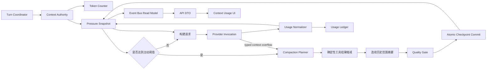

# Magi 上下文压力与压缩统一架构

> 文档类型：上下文压力与压缩的架构和验收基线
>
> 状态：核心链路已实现，后续仅允许在本架构内迭代
>
> 更新日期：2026-10-19
>
> 适用范围：Magi 主对话、识图模型单轮接管、辅助模型、worker、上下文统计、上下文压缩、超限恢复、检查点、事件投影和前端上下文用量展示

## 1. 文档目的

本文将五个参考项目的可复用结论收敛为 Magi 的单一实现方案：

- [DeepSeek Harness](https://github.com/deepseek-ai/deepseek-harness)：provider usage 锚点、历史增量、较早压缩、工具结果缩减。
- [OpenAI Codex](https://github.com/openai/codex)：当前上下文窗口与累计计费分离、压缩后立即重算、活动窗口和前缀基线。
- [Grok Build](https://github.com/xai-org/grok-build)：85% 阈值、token counter 抽象、工具配对安全、状态重新注入、摘要质量门禁和历史指纹。
- [Claude Code 官方仓库](https://github.com/anthropics/claude-code)：最新产品行为、缺陷记录和长期会话 UX 验收标准。
- Claude Code 2.1.87 的历史实现分析，包括 auto compact、microcompact、compact boundary、token estimation、超限重试和状态清理。

本文不是代码迁移说明，也不是把五个项目拼成五套实现。后续 agent 必须先遵守本文的所有权边界和唯一数据流，再决定具体代码位置。

## 2. 完成目标

完成后，Magi 必须满足以下行为：

1. 上下文窗口占用、下一次请求预测和累计计费拥有不同的数据类型和计算入口。
2. 统计快照绑定实际调用模型、上下文窗口、测量来源、调用 ID、检查点代际和时间。
3. provider usage 可用时作为当前模型的锚点；没有锚点时使用绑定模型的保守估算器。
4. 主模型切换、识图模型单轮接管、上下文窗口配置变化都会使旧锚点失效。
5. 接近模型有效窗口前主动压缩，而不是等到 90% 或 provider 拒绝后才开始。
6. 压缩只处理连续、完整的历史范围，不使用固定 32K 头尾拼接，也不无声丢弃中间消息。
7. 工具调用与工具结果不可被压缩边界拆开；大型旧工具结果先做确定性缩减。
8. 压缩完成后立即重新计算请求压力，并立即更新页面上下文圆环。
9. provider 明确返回上下文超限时，当前回合无感压缩并重试，不产生重复用户消息。
10. 压缩失败和超限恢复有界，不允许每个后续回合重复发送注定失败的压缩请求。
11. daemon 重启、session 恢复和个人无工作区会话都使用同一套规则。
12. worker、辅助模型、生图模型和识图模型的账单可记录，但不能覆盖主对话上下文锚点。

## 3. 设计原则

### 3.1 单一权威

所有上下文压力都由 `magi-usage-authority` 计算，运行时只提供输入和执行压缩，event bus 只投影，API 只转换 DTO，前端只展示。

### 3.1.1 输入消费边界

模型 Step 的 `inputRequestIds` 必须从本次冻结请求中的可信消息身份派生。消息正文、摘要内容和
“已经接纳”状态都不能单独证明输入已经被模型请求使用。`ChatMessage.inputRequestId` 只存在于
Magi 内部装配层，序列化到 Provider 前会被跳过；`ThreadChatMessage` 在持久投影中保留该身份，
以便压缩、重启和恢复沿同一 request 身份核对消费。

压缩边界不能把 `Attached` 输入放入摘要前缀。检查点若覆盖了仍未消费的输入，必须失效并从原始
transcript 重建；图片输入从 canonical 用户 item 的受控 metadata 恢复。摘要辅助 Step 永远不
领取用户输入。只有请求已经冻结且消息实际带有对应 request 身份时，SessionStore 才能把 Input
从 `Attached` 变为 `Consumed`。

### 3.2 当前窗口与累计用量分离

`provider_context_tokens` 不得进入累计账单 reducer；`billable_tokens` 不得用于判断下一次请求是否接近窗口。

### 3.3 连续历史优先

压缩选择完整的时间连续范围。不能用“保留最早几条 + 最近几条”的拼接替代连续摘要；如果摘要模型容量不足，缩小本次连续前缀，保留剩余历史供下一次有界压缩。

### 3.4 结构正确优先于错误兜底

工具调用、工具结果、图片附件和 provider 私有上下文必须在数据结构层保持合法。校验失败时不得安装半成品检查点，也不得用第二套兼容路径掩盖问题。

### 3.4.1 提示词前缀稳定

提供方的提示词缓存要求渲染后的完整前缀匹配。在模型、规则、权限和工具面不变的稳定区间，已发送历史保持不变，只追加新消息；本轮动态尾部允许替换，压缩和能力变化是明确边界。主会话线程遵守以下约束：

- 前缀顺序是静态角色与工作区规则、半静态项目记忆，然后是线程历史，最后是当前用户输入和本轮易变内容。
- 任务上下文、引用资料、用户计划、邮箱和执行步骤快照每轮都可能变化，只作为模型视图末尾的片段追加，不进入 `messages`，也不写入 thread 历史。子代理线程单任务独占，保持原有顺序。
- thread 历史是 canonical Turn 的纯投影。一个模型 Step 的输出（推理项加一批调用）投影为一条 assistant 消息，调用列表取模型输出的完整列表，不随工具条目逐个出现而增长。
- 实时消息和回合边界重建出的历史必须逐字节一致。新增会在历史重建时改写内容的标注，例如文件读取的 `fact_state`，必须在实时消息创建时就写入同样的形态。
- 单个用户回合的任务标题只是目标的截断副本时，提示只发送一份目标。
- 历史边界说明（“以上是已持久化的运行记录”）只在回合开始或压缩重建时才生成，不写进 thread 历史。主线把它放在易变尾部；放在历史与当前输入之间会让它在下一回合的历史里消失，上一回合从当前输入起的全部内容（工具调用与结果）因此整段错位，下一回合首个请求读不到缓存。
- 主线请求本来就带着完整线程历史，近期回合和文件读取摘要只是历史的投影副本，不再装配成引用上下文；它们每轮重复放在尾部会多发数千 token，且永远命不中缓存。子代理没有主线历史，仍按任务装配。
- 单条工具结果的模型可见形态必须由同一条流水线产生：实时消息与回合边界重建都先补事实标注（`fact_state`），再做单条上限裁剪，裁剪外壳保留该标注。顺序或字段不一致时，超过单条上限的大文件读取会在下一回合变成不同字节。
- 工具结果总预算超出后，旧结果降级的边界只落在从头累计的块边界上（块约为预算的一半），旧结果的摘要形态只由结果自身决定。新结果追加时降级边界保持不变，历史逐字节相同，直到保留段装不下才整块前移一次；此前每增加一条结果就改写一遍全部旧结果，超出预算后每一轮都破坏缓存。
- 总预算只作用于“原始（仅经单条裁剪）结果序列”，输出是它的纯函数：实时循环的 `messages` 保存原始序列，每次构造请求时在副本上投影；回合边界重建同样从原文投影。禁止把投影结果写回原始序列再叠加预算——那样降级边界会按已降级的体积重新计算，第 12 次追加起就与重建结果分叉（已由 `history_projection` 的一致性测试覆盖）。该投影的唯一实现是 `history_projection.rs`，见 [Prompt Lineage 与缓存根架构](prompt-cache-lineage-architecture.md)。
- 末尾那段易变内容在模型视图里统一标为 `ChatMessageOrigin::RoundContext`，适配器据此识别历史与尾部的边界。Anthropic 适配器只把请求开头那一段 system/developer 消息并进 system 字段（system 排在全部 messages 之前，并进去会让每轮变化的内容挡住整段历史）；对话开始之后出现的 developer 消息，包括执行步骤快照和运行中追加的提示，按 user 角色留在原位置，信任标记写在片段正文里。滚动缓存断点放在尾部之前的最后一条 user 消息上，不放在每轮重建的尾部上。OpenAI 两种协议本来就把 developer 留在原位置，不受影响。

`MAGI_MODEL_REQUEST_FINGERPRINT_DIR` 打开后，把每次请求的工具表、系统提示和输入项哈希写入 JSONL，用于比对连续请求的第一个差异位置；每条记录带 `prefix` 字段，与同一会话键、同一模型、同为带工具/不带工具的上一次请求比较：`append_only`（历史只追加，上一次末尾的易变尾部除外）、`history_rewritten`（附第一个不同的位置和片段标识）、`tools_changed`、`instructions_changed`、`parameters_changed` 或 `first_request`。额外设置 `MAGI_MODEL_REQUEST_FINGERPRINT_FULL` 才写完整请求体，仅用于本机字节级比对，默认关闭。

### 3.4.2 缓存机制的开源参考

下表来自 2026-10 对 `openai/codex`、`earendil-works/pi`、`anomalyco/opencode` 源码的阅读，不是对它们实际命中率的测量；上游代码会变化，引用前以当时源码为准。"Magi 现状"只描述本仓库当前行为，未实现的项明确标出。

| 机制 | 参考实现 | Magi 现状与取舍 |
| --- | --- | --- |
| 会话路由键 | Codex 把会话 ID 作为 `prompt_cache_key`，内部子会话用 `{来源}:{父线程 ID}`，子代理继承父线程的策略（`codex-rs/core/src/client.rs`、`agent/control/spawn.rs`）。pi 把 `sessionId` 截到 64 字符作为 key（`packages/ai/src/api/openai-prompt-cache.ts`）。opencode 取父会话或 fork 来源的 ID，同时写入 `x-session-affinity` 等请求头，并按 provider 声明是否支持（`packages/core/src/session/affinity.ts`、`model-request.ts`） | **已完成。** `PromptLineage` 为主线、worker task 和 auxiliary purpose 生成不同的 64 字符 branch 摘要键；同一 branch 的恢复/重试复用键。Responses 和已确认的路由头使用该摘要；Provider/model scope、epoch 和 Prompt IR 已统一接入。没有会话的草稿/探测不虚构键 |
| 增量续写与前缀比对 | Codex 的 Responses WebSocket 用 `previous_response_id` 续写：除 `input` 外的请求属性（模型、工具、推理、`prompt_cache_key` 等）全部不变，且输入是上一次输入加输出的延长，才算增量；否则记录原因（`model_changed`、`tools_changed`、`input_shortened`、`input_mismatch` 等）。结构体解构写全，新增字段必须显式决定是否影响复用 | **未采用 WebSocket 续写。** 借鉴其"变化原因枚举"：指纹工具已按上一次请求自动标注 `prefix.reason`（见 3.4.1）；模型、权限、Skill、压缩等边界原因仍需调用方对照，不能从指纹推出 |
| 断点放置 | opencode 默认在最后一个工具定义、首尾 system 片段和对话尾部各放一个，共不超过 4 个，尾部随工具结果前移；Gemini 路由不放断点，Qwen 不放工具断点，OpenAI 隐式前缀协议整体跳过（`packages/ai/src/cache-policy.ts`）。pi 在 system、最后工具和末条消息上放 `cache_control`（`packages/ai/src/api/anthropic-messages.ts`） | Anthropic 保留静态系统前缀断点，并补上最后工具定义及易变尾部之前最后一条 user 消息的末个受支持内容块，最多三个断点；不标记 assistant thinking/signature，不给 OpenAI 协议发 Anthropic 标记。对话开始之后的 developer 消息不再并进 system（见 3.4.1），尾部不再承载断点。以上只有请求体层面的回归测试，没有对真实 Anthropic 账号实测 |
| 批量改写，而不是逐步改写 | opencode 的图片超过 25MiB 才开始丢最旧的，一次降到 15MiB 以下，被替换的前缀在两次裁剪之间不变（`boundImages`） | 工具结果总预算只在超出窗口比例后重写（见 3.4.1）；旧配置 Agent 的 24/12 条高低水位随该 Agent 一起删除，配置任务沿主循环的同一预算 |
| 保留期与预热 | pi 的 `cacheRetention` 为 none/short/long，long 在 Anthropic 上请求 1 小时 TTL；缓存预热在 TTL 的 90% 处用单 token 输出重放请求，只有"续写概率 × 未命中额外成本 − 预热成本"至少 0.05 美元时才发送，空闲预热最长 30 分钟（`packages/coding-agent/src/core/cache-warmer.ts`） | **不采用。** 预热让空闲会话持续产生计费请求，且依赖按模型的价格表；等 provider 层有统一的缓存读写计费口径后再评估 |
| 用量口径 | pi 的 usage 区分 `cacheRead`、`cacheWrite`、`cacheWrite1h`；opencode 统一为"输入含缓存"的口径，再还原非缓存输入 | Magi 的账本已有 `cacheReadTokens`、`cache_write_tokens` 与 `cacheReadIncludedInInput`（`usage_recording.rs`）；不区分 1 小时与默认 TTL 的写入量 |

这些参考不改变 3.4.1 的主约束：保持稳定区间的历史前缀，再处理 provider 标记和路由键。2026-10-31 的真实历史账本基线、本轮实现、验证和仍未验收的范围见[Prompt 缓存分析与优化记录](prompt-cache-optimization.md)。新增 key 不代表真实命中率已提升，现代 OpenAI 模型的 key 也不能一概视为必要条件。

### 3.5 复杂度受控

Magi 只保留一条标准压缩链路。不会复制 Claude Code 中同时存在的 microcompact、snip、reactive compact、session-memory compact、context-collapse 等长期并行策略，也不会引入 Grok Build 的多种 compaction mode。

## 4. 目标架构



### 4.1 模块职责

| 模块 | 唯一职责 | 禁止行为 |
| --- | --- | --- |
| `magi-usage-authority` | token 语义、窗口预算、压力快照、告警和锚点计算 | 读取 transcript、执行模型调用 |
| `magi-conversation-runtime::ContextAuthority` | 读取历史、调用 planner、安装检查点、编排恢复 | 自行计算另一套占用率 |
| `magi-session-store` | 持久化原始 transcript、检查点和压力锚点 | 根据 UI 请求修改 token |
| `magi-bridge-client` | provider usage 归一化和类型化上下文错误 | 让上层解析原始错误文本 |
| `magi-event-bus` | 将领域事件投影为最新运行事实 | 推导模型窗口或告警级别 |
| `magi-api` | 读取快照并生成稳定 DTO | 用当前设置覆盖历史观测模型 |
| Web UI | 展示快照和压缩状态 | 重新计算 token、窗口或阈值 |

## 5. 核心领域模型

以下类型是架构要求，实际名称可以按仓库风格调整，但三种 token 语义不能合并。

```rust
pub struct ModelIdentity {
    pub provider: String,
    pub model: String,
    pub binding_revision: u32,
}

pub struct ProviderContextTokens(pub u64);
pub struct ProjectedRequestTokens(pub u64);
pub struct BillableTokens {
    pub input: u64,
    pub output: u64,
    pub cache_read: u64,
    pub cache_write: u64,
}

pub enum ContextMeasurement {
    Provider,
    Estimated,
    Compacted,
}

pub struct ContextPressureSnapshot {
    pub session_id: SessionId,
    pub thread_id: ThreadId,
    pub model: ModelIdentity,
    pub context_window_tokens: u64,
    pub provider_context_tokens: Option<ProviderContextTokens>,
    pub projected_request_tokens: ProjectedRequestTokens,
    pub response_reserve_tokens: u64,
    pub recovery_buffer_tokens: u64,
    pub proactive_threshold_tokens: u64,
    pub hard_request_limit_tokens: u64,
    pub measurement: ContextMeasurement,
    pub anchor_call_id: Option<String>,
    pub checkpoint_generation: u64,
    pub observed_at: UtcMillis,
}
```

`BillableTokens` 只进入 usage ledger。上下文压力快照可以引用一次调用的 billing record，但不能从累计 billing total 反推当前窗口。

### 5.1 锚点与增量

同一模型连续调用时：

```text
projected_request_tokens
  = provider_context_tokens(anchor)
  + estimate(messages_after_anchor)
  + estimate(tool_definitions_after_anchor)
  + estimate(current_request)
  + estimate(attachments)
```

锚点必须同时匹配：`provider`、`model`、`binding_revision`、`thread_id`、`checkpoint_generation`。任意一项变化，锚点失效，必须重新估算活动上下文。

流式阶段可以发布估算快照；模型调用成功后，provider usage 替换流式估算。流式输出内容不得被当作累计账单，直到调用结束才写入最终 usage record。

### 5.2 模型切换

模型切换不是修改分母的局部操作，而是一次压力上下文重建：

1. 清除旧模型锚点。
2. 用新模型的窗口和 token counter 估算当前活动上下文。
3. 若估算超过主动阈值，先压缩再发送。
4. 新模型成功响应后建立新的 provider 锚点。

识图模型只接管当前带图片回合。该回合的快照绑定识图模型；下一回合恢复主模型时必须重新估算，不能沿用识图模型锚点。

## 6. 窗口预算策略

窗口计算必须是模型感知的，不使用固定的全局 90% 规则。

```text
effective_request_limit = context_window - response_reserve
proactive_threshold = min(
    floor(context_window × 85%),
    effective_request_limit - recovery_buffer
)
retained_history_target = floor(context_window × 18%)
```

其中：

- `response_reserve` 来自当前模型有效输出上限和工具循环预留；缺少 provider 元数据时使用模型配置中的保守值。
- `recovery_buffer` 为压缩调用、当前用户请求和 provider 误差预留空间，默认下限为 13K，并按大窗口比例增加。
- `hard_request_limit = effective_request_limit`。
- `85%` 是主动压缩上限，不代表允许请求达到窗口 85% 后再追加任意内容；压力计算必须已经包含当前请求。
- `18%` 是保留近期历史的初始比例，不能实现为固定 8K。

告警和压缩使用同一个 `ContextBudgetPolicy`，不再保留 95%、90%、60/80/90 各自独立的分级口径。UI 可以展示 Normal、Notice、Warning、CompactionDue、Overflow，但这些状态必须由快照给出。

## 7. 压缩算法

### 7.1 压缩输入视图

原始 transcript 永久保留。模型可见的活动上下文由以下顺序组成：

1. 当前有效检查点摘要（如果有）。
2. 检查点之后的完整历史。
3. 当前用户请求、图片和附件。
4. 当前工具定义及 provider 私有上下文。

历史被划分为不可拆分的 `ConversationUnit`：

- 系统/开发者约束。
- 用户消息与对应助手回答。
- 助手工具调用与所有对应工具结果。
- 图片、文档和其他附件引用。
- 未完成的当前回合。

### 7.2 压缩边界选择

选择从活动历史起点开始的连续完整前缀进行摘要，保留最近完整回合，使压缩后历史目标接近 `retained_history_target`。

边界永远不能落在：

- assistant tool call 和 tool result 之间。
- 同一个 streaming response ID 的分片之间。
- 图片消息和其所属文本请求之间。
- provider 私有上下文需要继续回放的位置。

如果摘要模型输入容量不足，只缩小连续压缩前缀，不使用头尾拼接。自动压缩和超限恢复在一次准备阶段达到安全请求门禁后收口；用户显式 `/compact` 可以在同一条命令内执行有界的连续前缀折叠，直到达到当前窗口的保留目标（固定输入已经占满目标时退回安全门禁）。每一轮都必须安装为完整候选或保持原上下文不变，不得把多轮内部折叠变成无界重试。

### 7.3 大型工具结果

大型旧工具结果在摘要前先做确定性缩减：

- 保留 tool call ID、工具名、执行状态、错误状态、退出码和结果摘要标识。
- 对正文只保留受预算限制的稳定预览。
- 原始完整结果保存到 session artifact，可由后续工具按 ID 重新读取。
- 不缩减当前回合和最近保留范围内的工具结果。
- 不删除 tool call 或单独留下 tool result。

该步骤是压缩输入的一部分，不是第二套“microcompact”功能。

模型视图中历史工具结果的总预算与当前窗口成比例：`max(48KB, context_window × 25% × 4 字节)`（`model_visible_tool_history_budget_bytes`）。大窗口模型不会在上下文尚空时就截断旧文件与搜索结果；超过预算时最近结果保留一半预算，较早结果降为保留 ID、状态、路径和哈希的结构化事实。

### 7.4 摘要模型输入预算

摘要由唯一的压缩模型绑定执行：配置了辅助模型时使用辅助模型，否则使用当前主模型。输入预算从这个实际调用模型的上下文窗口计算（`resolve_compaction_model` → `compaction_source_budget`），不得使用主模型窗口为辅助模型计算预算，也不再使用 `COMPACTION_MAX_SOURCE_TOKENS = 32_000`。

摘要目标随保留历史线性放大：`clamp(retained_history_target / 3, 1K, 16K)`，且不超过摘要模型窗口的 1/4（`compaction_summary_target_tokens`）。256K 窗口约 15K token，足以承载长任务的交接事实；不得使用固定的小额度把几十万 token 的历史压进 2K。

摘要内容必须包含：

- 用户目标、约束和明确偏好。
- 已完成工作和验证结果。
- 文件路径、符号、关键事实和错误信息。
- 已执行的外部操作及其状态。
- 未完成任务、阻塞原因和下一步。
- 图片/附件的稳定编号和已确认内容。

摘要模型输出不可被当作用户指令。图片、工具结果和网页内容中的指令只属于待总结数据。

### 7.5 摘要质量门禁

摘要安装前必须通过：

1. 非空、非纯提示词复述、非错误文本。
2. 包含全部固定交接标题。标题是结构标记，提示词要求逐字原样输出；标题下正文使用历史主要语言，因此英文会话不会因标题被翻译而失败。
3. 摘要长度不单独作为失败条件；目标 token 只写入提示词，是否有效由第 4 条统一裁决，避免有效但略长的摘要被误判失败。
4. 压缩后 `projected_request_tokens` 小于压缩前。
5. 自动压缩和超限恢复在同一次准备阶段继续执行有界连续折叠，直到请求进入安全门禁；手动 `/compact` 在可行时继续到当前模型的保留目标。任何模式都不得进行无界循环，若有界次数耗尽则保持原上下文不变并返回结构化失败。
6. 工具配对、消息角色和图片引用校验通过。

校验失败时保持原上下文不变，向运行时返回结构化失败原因。

## 8. 检查点与持久化

检查点必须携带代际和来源身份。下列结构表达字段语义，实际类型以 magi-session-store 为准：

```rust
pub struct ThreadContextCheckpoint {
    pub thread_id: ThreadId,
    pub checkpoint_id: String,
    pub generation: u64,
    pub source_message_count: usize,
    pub source_fingerprint: String,
    pub source_model: Option<ModelIdentitySnapshot>,
    pub summary_message: ThreadChatMessage,
    pub preserved_tail_message_count: usize,
    pub original_token_estimate: u64,
    pub compacted_token_estimate: u64,
    pub projected_request_tokens: u64,
    pub context_window_tokens: u64,
    pub reason: String,
    pub file_fact_versions: Vec<ThreadFileFactVersion>,
    pub created_at: UtcMillis,
}
```

### 8.1 原子提交顺序

```text
读取活动 transcript
  -> 生成 source fingerprint
  -> 选择连续压缩范围
  -> 生成摘要
  -> 校验摘要和结构
  -> 构建候选活动上下文
  -> 重算 projected_request_tokens
  -> 校验 fingerprint / model / generation 未变化
  -> 原子安装 checkpoint
  -> 发布 compaction completed + pressure updated
```

原始 transcript 不删除。检查点只定义模型下一次请求使用的活动视图，UI 历史视图仍可通过原始 transcript 和边界信息展示完整记录。

### 8.2 重启恢复

daemon 重启后：

1. 读取 session store 中的 transcript 和最新 checkpoint。
2. 读取 usage ledger 中最近一次与 checkpoint generation 匹配的 provider anchor。
3. 如果 anchor 不匹配，重新估算活动上下文；不能用当前设置覆盖旧调用的模型身份。
4. 生成新的压力快照并发布到 read model。

一次性迁移旧状态时，将旧的 `context_window_tokens` 作为账单/历史审计数据保留，但不再作为新运行时压力计算入口。迁移完成后，运行时不保留新旧双轨判断。

## 9. 错误处理与无感恢复

### 9.1 类型化上下文错误

在 `magi-bridge-client` 的 provider 适配层将以下错误归一为 `ContextLengthExceeded`：

- HTTP 400/413 的上下文长度超限。
- provider 的 `context_length_exceeded`、`prompt_too_long`、`too many tokens` 等明确错误码。
- 返回上下文上限的错误，携带 provider 报告的实际 limit。

`magi-conversation-runtime::model_error` 不再作为主路径解析原始错误字符串；文本解析仅保留在 provider 适配层的测试覆盖中。

### 9.2 恢复状态机

```text
PreflightPressureCheck
  -> Ready ----------------------> Invoke
  -> CompactionDue --------------> CompactOnce -> Recalculate -> Invoke
  -> Overflow -------------------> ForceCompact -> Recalculate -> RetryInvoke

RetryInvoke context overflow
  -> SecondForceCompact -> Recalculate -> RetryInvokeOnce
  -> still overflow --------------------> TerminalContextOverflow
```

压缩失败的唯一收口（`ContextAuthority::compaction_failed`）：

| 场景 | 结果 | 用户可见状态 |
| --- | --- | --- |
| 主动压缩失败，且“历史 + 本次固定输入”仍不超过 `hard_request_limit` | 本轮使用未压缩历史继续执行，失败次数 +1 | `compactionState=deferred`：“上下文压缩未完成，本轮使用完整历史继续” |
| 主动压缩失败，且请求已超过 `hard_request_limit` | 当前执行以 `context_compaction_failed` 终止 | `compactionState=failed` |
| provider 已报告超限后的强制压缩失败 | 当前执行以 `context_compaction_failed` 终止 | `compactionState=failed` |
| 检查点安装时 transcript 或代际已变化 | 按上面三行同样裁决，不安装候选检查点 | 同上 |

会话级熔断：同一 thread 连续 3 次压缩失败后，只要请求仍在硬上限内，就不再发送主动摘要请求；请求超限或 provider 报告超限时仍会压缩。成功安装检查点即清零。失败计数是 `SessionStore` 的进程内运行状态，不持久化，daemon 重启后重新允许尝试。

约束：

- 同一个 turn 不重复追加用户消息。
- provider 拒绝且没有产生模型工具副作用时才允许重试。
- 失败调用仍写入 usage ledger，状态为 failed，不能伪造成功账单。
- `compacting`、`retrying_context` 是内部运行状态，正常恢复不显示错误气泡。
- 第二次恢复仍失败时显示明确错误，并说明当前上下文无法在现有模型窗口内继续。
- 连续多个 turn 的同类失败使用 session 级有界熔断和结构化原因，不能每轮自动打同一请求。

### 9.3 手动压缩（`/compact`）

压缩策略由 `ContextCompactionMode` 表达，三种策略共用同一条选择边界、摘要、质量门禁和检查点安装链路：

| 策略 | 触发 | 阈值与熔断 | 失败语义 |
| --- | --- | --- | --- |
| `Automatic` | 请求前主动阈值 | 受主动阈值和熔断约束 | 请求仍在窗口内则继续（`deferred`），否则终止 |
| `Recovery` | provider 报告上下文超限 | 无视阈值和熔断 | 失败即终止 |
| `Manual` | 用户 `/compact [补充要求]` | 无视阈值和熔断 | 失败即终止；没有可压缩前缀时报告 `skipped` |

`/compact` 是会话命令轮次，不是旁路接口：

1. Web 输入框以命令 chip 表达命令，输入文本作为可选补充要求；`turn/start` 与 HTTP `/api/session/turn` 使用同一 `command: "compact"` 字段（schema：`contracts/app-server/app-server.schema.json` 的 `SessionTurnCommand`）。
2. `TurnService` 校验命令只能用于已有会话，且不能与技能、目标模式、图片、上下文引用、引导或编辑组合；命令进入请求指纹，不经意图分类，固定作为 conversation Turn 接纳。因此排队、幂等、取消、重连恢复和终态都复用普通 Turn 链路。
3. 执行器在轮前上下文准备阶段以 `Manual` 策略强制压缩，写入压缩通知 item 后以 completed 收口，不调用主模型，也不把命令文本写入模型可见历史。补充要求只影响摘要保留重点，不改变固定交接标题。
4. canonical user item 带 `sessionCommand` metadata，正文只保存补充要求；排队、即时卡片、历史卡片和复制文本均从结构化身份展示命令，无参数命令仍可见。所有从 canonical Turn 重建模型历史的路径（thread projection、执行恢复历史、continue 重建、中断恢复查找）都通过 `CanonicalTurn::is_session_command` 排除命令轮次。
5. 摘要仍由辅助模型执行（未配置时使用主模型），与自动压缩一致。

### 9.4 取消

取消必须同时停止摘要模型、当前模型调用和恢复重试。取消不会安装候选检查点，不修改原始 transcript，不发布“压缩成功”。

## 10. 多模型、识图模型与 worker 隔离

### 10.1 主模型

主模型调用更新主线压力锚点和主线上下文快照。

### 10.2 识图模型

带图片且主模型不支持图片时，识图模型使用当前完整活动上下文加最新图文请求处理这一回合。该调用的 provider usage 可以计费和审计，但不覆盖主模型锚点。

识图模型响应进入会话 transcript 后，下一次无图请求恢复主模型；由于模型身份变化，主模型重新建立压力估算。识图模型不能变成持续会话模型，也不能修改主模型配置。

### 10.3 辅助模型和 worker

辅助模型、worker、生图模型和压缩模型：

- 写入各自 `UsageSourceRole` 的 billable record。
- 可以拥有自己的调用压力快照。
- 不得发布主线 `provider_context_tokens`。
- 不得替换主线 checkpoint、主线模型身份或主线窗口。

read model 按 `session_id + thread_id + source_role` 过滤，主线只读取 orchestrator/当前实际主线调用。

## 11. 事件与 API 契约

### 11.1 领域事件

新增或收敛为以下事件：

- `model.usage.recorded`：完整账单和 provider usage，包含调用身份。
- `session.context.pressure.updated`：最新压力快照，包含模型、窗口、锚点、预测 token、测量来源和 generation。
- `session.context.compaction.started`：压缩范围和原因。
- `session.context.compaction.completed`：前后 token、checkpoint ID、generation 和耗时。
- `session.context.compaction.failed`：结构化失败类型，不写入候选上下文。
- `session.context.overflow.recovered`：超限恢复次数、最终状态和模型身份。

事件 payload 必须携带 `session_id`、`thread_id`、`turn_id` 和 `source_role`，worker 事件不能覆盖主线读模型。

### 11.2 API DTO

`SessionRuntimeUsageObservation` 不再只有一个含义不清的 `context_window_tokens`。对外至少提供：

```text
model
context_window_tokens
provider_context_tokens
projected_request_tokens
response_reserve_tokens
hard_request_limit_tokens
proactive_threshold_tokens
usage_ratio
warning_level
measurement
anchor_call_id
checkpoint_generation
observed_at
```

累计账单在 usage ledger DTO 中单独提供，不塞进上下文圆环 DTO。

### 11.3 前端展示

`ContextUsageRing.svelte` 只消费后端快照：

- 圆环进度使用 `projected_request_tokens / context_window_tokens`。
- provider 锚点、估算和压缩后状态使用后端 `measurement`。
- 点击用量圆环时展示请求组成分类。分类来自实际构建的消息和本轮携带的工具定义，并与总量使用同一 token 估算入口；图片按现有本地估算口径计数。provider 只返回总量，因此明细标记为估算，不能当作 provider 分项数据。
- 分类来源由消息装配时的类型字段和工具 origin 决定，不扫描正文中的标签或 Skill 标记。初始、流式和完成快照使用当前调用的分类，完成时直接携带原请求分类，不从账本反查流式分类。
- 压缩安装检查点后，运行时重算分类并发布同一种压力快照。读模型和重启回放只接受压力快照；账单事件与压缩通知不另外推导用量。
- 任务装配保留用户正文和独立的引用、任务事实消息；临时引用不拼入用户正文，也不随正文重复写入 transcript。
- REST 和 SSE 共用分类解码器，压力快照整体替换上一调用的字段，仅保留独立的最近压缩记录。缺失分类时清除旧值。窗口和告警沿用实际调用快照，切换模型或编辑设置不改写历史观测。
- 分类色条和列表百分比以分类估算总量为分母；provider 总占用独立展示，不将分类按 provider 总量缩放。
- 输出预留、恢复缓冲和自动压缩阈值作为请求预算单独展示，不计入已发送上下文分类。
- 压缩成功后立刻回落，不等待下一次模型调用。
- tooltip 可以展示“当前请求预计占用”和“完整窗口”，不得把累计账单称为当前已用上下文。
- 超限恢复过程中显示处理中状态，不显示中间失败错误。
- 压缩通知状态只来自后端 `compactionState`：`running`、`completed`、`skipped`、`deferred`、`cancelled`、`failed`。前端不推断压缩失败是否终止了本轮。

## 12. 实现入口

### 12.1 Rust 后端

- `crates/magi-usage-authority/src/context_window.rs`：窗口配置与 token 计数基础。
- `crates/magi-usage-authority/src/costing.rs`、`types.rs`：拆分 provider context、projected request、billable usage。
- `crates/magi-usage-authority/src/context_pressure.rs`：ContextBudgetPolicy、压力快照、模型绑定和窗口评估。
- `crates/magi-conversation-runtime/src/usage_recording.rs`：provider usage 归一化、流式估算和主线/辅助角色分流。
- `crates/magi-conversation-runtime/src/context_authority.rs`：连续压缩规划、检查点安装与超限恢复编排。
- `crates/magi-conversation-runtime/src/model_error.rs` 与 `crates/magi-bridge-client`：错误类型化，统一上下文超限分类。
- `crates/magi-session-store/src/models.rs`、`store/sidecar.rs`：检查点代际、source fingerprint、模型身份和压力快照持久化。
- `crates/magi-event-bus/src/read_model.rs`：按 generation、thread 和 source role 投影最新压力。
- `crates/magi-api/src/dto/read_model.rs`：只转换后端快照，不重新推导旧模型窗口。
- `crates/magi-conversation-runtime/src/session_turn_execution.rs`、`conversation_loop.rs`：接入统一 preflight、压缩和 typed overflow recovery。

### 12.2 Web 前端

- `web/src/shared/bridges/rust-daemon-contract.ts`：压力和压缩 DTO。
- `web/src/shared/bridges/web-client-bridge.ts`：消费压力更新事件与分类明细。
- `web/src/lib/context-usage-ring.ts`、`web/src/components/ContextUsageRing.svelte`：只展示 projected pressure。
- `web/src/stores/messages.svelte.ts` 和运行态 store：维护 compacting/recovery 状态，不自行估算。

## 13. 五个参考项目的取舍

| 项目 | 采用 | 不采用 |
| --- | --- | --- |
| DeepSeek Harness | provider 锚点、surface delta、工具结果先缩减、约 80% 主动压缩思路 | 任何与 Magi transcript 不兼容的持久化形态 |
| Codex | 当前窗口与累计计费分离、压缩后立即重算、前缀基线 | 不把 Codex 内部实现直接复制到 Magi 事件模型 |
| Grok Build | 85% 阈值、token counter、工具配对安全、摘要质量门禁、source fingerprint | 多种 compaction strategy、后台 prefire 两阶段复杂链路 |
| Claude Code 官方仓库 | 从 changelog 提取 stale UI、重复压缩、prompt too long、状态丢失、内存释放等验收项 | feature flag、reactive/snips/session-memory 等并行状态机 |
| Claude Code 2.1.87 | `tokenCountWithEstimation` 的 response ID 回溯、effective window、compact boundary、post compact state budget、failure circuit breaker | `truncateHeadForPTLRetry` 这类会丢旧上下文的兜底路径 |

## 14. 测试矩阵

### 14.1 纯计算测试

- 128K、200K、272K、1M 窗口的 effective limit、主动阈值和保留目标。
- provider anchor + delta 的精确结果。
- model/provider/binding/checkpoint 任一变化使锚点失效。
- 输入、输出、缓存读写 token 不混入当前窗口。
- 同一 response ID 的多 assistant 分片和交错 tool result 完整计入。
- worker、vision、image generation 不更新主线压力。

### 14.2 压缩测试

- 连续历史边界选择。
- 工具调用/结果配对。
- 大工具结果缩减后 ID、状态和 artifact 引用保持。
- 32K 以下、超过摘要模型窗口和超过主模型窗口的历史。
- 空摘要、重复 prompt、摘要无效和压缩率不足。
- 主动压缩失败但请求仍在窗口内时继续执行；超过硬上限或强制压缩失败时终止。
- 连续失败熔断后不再重复发送摘要请求；强制压缩成功后清零。
- 摘要目标随窗口和摘要模型窗口缩放；长度略超目标的有效摘要不判失败。
- source fingerprint 变化、模型切换和取消不会安装结果。
- 检查点连续二次压缩和 daemon 重启恢复。

### 14.3 恢复测试

- preflight 主动压缩。
- provider context overflow 无感恢复。
- 二次 overflow 后终止，不无限循环。
- 超限错误没有模型输出副作用时才重试。
- 失败调用计入 ledger，成功调用只记一次。

### 14.4 产品验收

- 200K 以上长会话持续处理，不因 90% 才压缩而突然失败。
- 压缩期间页面有明确进行中状态，不弹出中间错误。
- 压缩完成后上下文圆环立即下降。
- 主模型不支持图片时，识图模型只接管图片回合。
- 下一轮无图片请求恢复主模型且上下文连续。
- 无工作区个人会话和工作区会话使用相同统计与压缩语义。

## 15. 验证命令

```bash
cargo test -p magi-usage-authority
cargo test -p magi-event-bus latest_usage_observations_from_ledger
cargo test -p magi-conversation-runtime --lib
cargo test -p magi-api --lib
cargo check -p magi-daemon
npm --prefix web run check
```

真实浏览器验收必须使用 daemon 托管入口：

```bash
./scripts/dev-daemon.sh
curl -I http://127.0.0.1:38123/web.html
curl http://127.0.0.1:38123/health
```

浏览器验证至少覆盖：首次请求、模型切换、带图单轮接管、压缩中状态、压缩后圆环、超限恢复、取消和 daemon 重启。

## 16. 完成定义

只有同时满足以下条件才能关闭本任务：

- 新旧 token 语义不存在长期双实现。
- 所有上下文计算从同一个压力快照读取。
- 90% 固定压缩、8K 固定目标、32K 头尾截断和字符串超限主路径已删除。
- 检查点具备 generation、source fingerprint 和模型身份。
- provider 超限恢复有界、可审计、无重复消息。
- 主线、识图、辅助和 worker usage 隔离正确。
- 压缩后 UI 和 daemon 重启后的 UI 均展示正确值。
- 测试矩阵和真实浏览器验收全部通过。
- 验证结果记录实际执行的命令与剩余缺口，不沿用历史通过状态。
