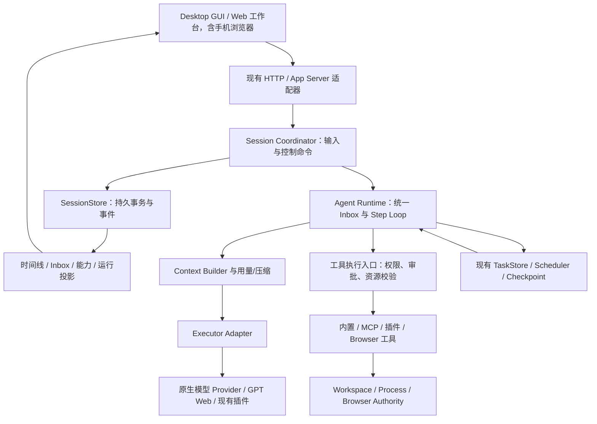

# Magi 产品与 Agent 运行时演进方案

更新：2026-10-19。当前进入存量收敛，暂停新增能力。本文保留目标、取舍与阶段退出条件；当前保留/移除项和验证结论以[收敛审计](runtime-consolidation-audit.md)为准。阶段编号不代表完成百分比，旧分轮实施记录已合并，避免早期状态覆盖当前事实。

## 1. 核心判断

Magi 应定位为**以主对话承接用户意图、以可持续运行的 Agent 完成工作、以工具和产物提供证据的工作台**。代码、浏览器、文件与文档、外部服务应使用共同的输入、执行、授权和恢复机制。多模型、子代理、Goal、插件都是这套运行时的组合能力。

产品范围限定为 Electron 桌面 GUI 与 Web 工作台。Magi CLI 已废弃；不开发独立移动端应用，手机和平板沿用同一 Web 工作台的响应式访问。外部 Agent Executor 只保留通用接口及历史证据读取，具体适配器、配置入口和专用验收已撤下，不属于当前改造的待完成项。下文对其他产品 CLI 的引用仅用于设计参考。

建议保留 daemon 作为业务权威、现有事件与持久化基础、BrowserAuthority、TaskStore、插件和权限基础设施。重点改造四个地方：

1. 把用户输入建模为有完整生命周期的持久对象，队列只是它的读取视图。
2. 主代理和子代理复用 Agent Loop、Inbox、Step、工具调用和恢复机制；控制权按资源范围授予。
3. 工具发现、工具加载、执行权限、宿主可用性、资源租约和运行保护分别表达，由同一解析结果驱动展示与执行。
4. 把长期工作从“反复强迫模型继续”改成有检查点、资源归属和明确停止原因的运行。

现有设计有合理基础，也存在已经影响产品行为的建模问题。只补 UI、解除所有限制，或直接重写整个 Rust 后端，都不能完整解决这些问题。

## 2. 本次查阅的一手资料与取舍

查阅日期为 2026-10-16。下列资料均实际打开读取；产品迭代较快，表中描述只对应查阅时的公开行为，不推断未公开实现。

| 参考 | 已核实的设计 | 对 Magi 的启发 | 需要自行取舍的部分 |
| --- | --- | --- | --- |
| Claude Code | 子代理独立上下文；可配置工具白名单、禁用项、模型、Skill、权限模式、worktree；后台代理审批回到主会话并标明来源；当前文档支持有深度限制的嵌套代理 | 专业角色与上下文隔离有价值；后台执行需要完整交互通道；限制应可解释 | 前台、后台、fork 的工具面存在差异，不能理解成所有代理完全同权；不照搬默认并发数与深度 |
| Codex CLI / App Server | Thread、Turn、Item 分层；`turn/steer` 绑定 `expectedTurnId`，不创建新 Turn，也不接受模型、目录和沙箱覆盖；子代理继承父轮沙箱与审批设置，自定义代理可减少部分能力；审批可从非当前代理线程浮现 | 明确输入目标；角色配置与授权边界分离；客户端通过服务端事实工作 | Codex 的权限继承与 Claude 的配置方式不同，没有“行业唯一正确权限模型”；外部协议不应成为 Magi 的内部数据结构 |
| DeepSeek Harness | 基于 Cordis 的可组合服务；一份 inbox 驱动 loop；Step 是模型请求及其工具，Turn 可包含多个 Step；模型可见历史从日志派生；区分持久事实和运行时扩展事件；本地可继续子代理与外部单次执行通过能力声明区分 | 输入与消费进入日志；建立稳定能力接口和释放合同；外部 agent 的能力必须真实协商 | 项目仍明确标注 developer preview；“一切插件化”是其产品选择，Magi 的授权和事实写入需要稳定可信内核 |
| ZCode | 同仓提供桌面、Web、CLI 与 Agent runtime；共享协议、客户端及业务服务；插件组合 Skill、命令、MCP；CLI 文档描述 PreToolUse、PermissionRequest、PostToolUse、Stop 等 Hook，Stop 续跑有上限 | 多端共用运行时与协议；扩展点围绕生命周期；生态内容与可执行能力分离 | 已公开内容不等于所有实现都经过验证；本次没有运行 ZCode，不能据此声称它已解决 Magi 的竞态或恢复问题 |

资料入口：

- [Claude Code：Subagents](https://code.claude.com/docs/en/sub-agents)，重点为 Available tools、Foreground/background、Nested subagents、Context。
- [OpenAI 官方文档：Subagents（CLI）](https://learn.chatgpt.com/docs/agent-configuration/subagents?surface=cli)，重点为 Approvals and sandbox controls、Custom agents。
- [OpenAI 官方文档：Codex App Server](https://learn.chatgpt.com/docs/app-server)，重点为 Core primitives、Steer an active turn、Approvals。
- [DeepSeek Harness 架构](https://github.com/deepseek-ai/deepseek-harness/blob/master/docs/architecture.md)。当前复核读取的仓库提交为 `1517a4dbca0a2789ff1d41ba439600f8547d23fa`。
- [DeepSeek Harness 子代理合同](https://github.com/deepseek-ai/deepseek-harness/blob/master/docs/subsystems/subagent.md)。
- [ZCode 官方仓库](https://github.com/zai-org/ZCode)，当前仓库主分支提交为 `aac4755666d09fdcd70272fcf063c077a639015f`；版本和文案以链接内容为准。
- [ZCode CLI 文档](https://github.com/zai-org/ZCode/tree/main/apps/zcode-cli)，重点为 Plugin Development、MCP、Hooks。

可以借鉴的共同方向是：持续的 agent 身份、独立上下文、明确输入边界、统一工具执行、可观察的生命周期和可继续的工作。各产品在权限、默认委派、嵌套深度和持久化方面有差异，不能把功能名称拼接成 Magi 架构。

### 2.1 代理唤起策略复审（2026-10-17）

本次复审读取当前工作区变更及创建、注册、模型工具定义、等待、取消、独立 Turn、恢复和工作树合入调用方。重点区分“主线接纳为内部 root Task”“模型具备代理工具”“真实创建子代理”：只有最后一项属于代理派发，Task/Goal 模式不要求多代理。

四个参考项目并没有相同的默认策略：

| 一手证据 | 实际唤起条件 | Magi 的取舍 |
| --- | --- | --- |
| [Codex 当前官方说明](https://learn.chatgpt.com/docs/agent-configuration/subagents) | 本地 App/CLI/IDE 在用户明确要求，或适用的 AGENTS.md/Skill 要求委派时使用；每个代理另耗模型和工具请求 | 遵守明确派发/禁止要求，不能因为开启 Goal 或看到多个文件就默认扇出 |
| [Claude Code：主线与子代理选择](https://code.claude.com/docs/en/sub-agents#choose-between-subagents-and-main-conversation) | 根据角色 description 匹配；适合高输出、自包含调查、独立摘要；快速修改、频繁澄清和共享大量上下文的连续阶段留在主线 | 保留有明确收益的自主委派，先判定隔离与并行价值，角色匹配只负责选择合适代理 |
| [DeepSeek Harness 工具实现，1517a4d](https://github.com/deepseek-ai/deepseek-harness/blob/1517a4dbca0a2789ff1d41ba439600f8547d23fa/packages/subagent/tool-subagent/src/index.ts) | 模型调用工具派发自包含研究、实现或分析；独立 spawn 与继承完成历史的 fork 分开说明，运行时负责深度和生命周期 | 唤起由模型按任务收益判断，运行时维护授权/容量/生命周期；不另建关键词或任务长度分类器 |
| [ZCode：Subagents](https://zcode.z.ai/en/docs/subagents) | 主 Agent 判断需要独立上下文或并行研究时调用 Agent；角色 description 指导匹配，也可显式指定 | 大范围独立探索可以委派，零散读文件或普通验证由主线直接完成 |

Magi 当前规则为：默认主线直接推进；仅在用户明确要求，或边界清晰的独立工作包能显著减少总耗时、隔离大量探索噪声、提供必要的独立复核时派发。任务时长、多文件、可用角色数、工具调用次数不构成独立理由；并行工具读取不等于需要并行 Agent。嵌套委派默认关闭，只有子任务本身值得进一步拆分时才传 `allow_delegation=true`，获授能力不要求创建孙代理。

## 3. 改造前审计基线：已核实的问题和限制

### 3.1 排队消息已发送却仍在列表

截图可以确认同一内容同时出现在主时间线与待处理列表；截图本身不能证明两个条目一定是同一 request，也不能确认当时运行的 daemon 构建版本。

当前 HEAD 的修复提交 `89c0d9b9` 给出了明确代码证据：原链路先发布 Turn accepted，再确认移除 durable queue；前端收到 accepted 立即读取队列，可能读到尚未确认出队的旧条目，且缺少对应刷新触发。修复增加读取与消费共用的会话提交锁，并补充接纳、引导、终态后的队列刷新。

因此这是一个已被当前代码针对性处理的**接纳与队列投影一致性问题**，不是仅仅忘记从一个前端数组里删除元素。是否在用户安装包中生效，还需要核对运行构建和端到端复现。

当前结构已完成这项收敛：`QueuedRegularSessionTurn` 只是从 SessionStore 的 pending `SessionInput` payload 派生的兼容投影，不再拥有第二份队列事实。初始排队只提交一个 pending Input；启动下一轮时，canonical Turn 接纳事务从同一用户 item 的 requestId/userMessageId 生成 attached Input mutation，随后 ModelStep 再把它变为 consumed，三者均经过同一 SessionStore 事务边界。若接纳前崩溃，Input 仍是 pending 且没有 canonical Turn，不会产生重复消息；若消费前崩溃，attached 输入可恢复。旧 queue 文件只做一次读取迁移，不再写回。

仍保留提交后事件刷新作为投影及时性优化；它不承担业务正确性，重连通过服务端 Input/Turn 序号重新收敛。

### 3.2 引导按钮不能点（历史问题与当前合同）

当前提交前，`task` 轮没有与主执行循环打通的 steer 输入通道，而普通消息大部分进入 `task`。这使产品展示了引导操作，但服务端长期返回不可用。

当前 HEAD 已给主线 task 开放输入边界，并在模型轮次之间消费 steer；收口时原子取走待处理输入或关闭输入边界，防止接纳后丢失。子代理不会消费 Session 的主线引导。

上述问题已经沿 SessionStore 的 Input/Turn 事务收口。当前合同如下：

- `guide` 返回结构化状态、不可用原因、目标 Turn、支持的输入形态和生效时机；Web 仅在服务端报告 `ready` 时启用按钮。
- 引导当前只接受文字和执行器明确支持的图片；文件引用、浏览器标注、插件选择、命令和目标控制输入保留在下一轮队列。
- “已接纳”“已进入模型请求”“已收到响应”和“结果待核对”由 Input/ModelStep 事实分别投影，不能用接纳回执推断已经生效。
- 长模型采样和工具调用期间，引导在下一模型 Step 边界消费，不承诺中断当前调用。
- Input 绑定到 canonical Turn 后从待处理队列移出；ModelStep 的 `inputRequestIds` 只记录实际冻结请求中的身份。压缩、重启和恢复不会把 Attached 输入误报为已消费。

### 3.3 主对话与子代理确实存在工具和调用限制

下表描述当前源码，不代表每项都应删除。

| 维度 | 当前行为 | 判断 |
| --- | --- | --- |
| 权限继承 | `agent_spawn_child_policy_snapshot` 克隆父 TaskPolicy；角色不会自动把 explorer/reviewer 降成产品级只读 | 应保留默认继承；“偏好只读”的提示词不能当成强制只读保证 |
| 模型轮数 | 旧主线 200、子代理 80 的差异已移除；当前 loop 共享每次 activation 的 1,000 轮保险，持久 transport attempt 另按 Agent 执行树共享 10,000 次上限 | 运行保护仍独立于用户任务预算；检查点、恢复和显式 Continue 不得重置执行树累计值，并保留部分结果与明确停止原因 |
| 只读探索 | 旧的读取轮数/调用数门槛已改为观测进展：连续 8 轮没有新证据时提示收束，12 轮时按原完成条件综合；不同参数或结果的新证据及成功的非 discovery 工具都会清除停滞计数 | 读取数量本身不再触发终止；相同调用与相同结果的重复读取不算新进展，其他运行保护仍生效 |
| 嵌套派发 | 根 coordinator 默认可见；子代理只有被父任务显式授予 `allow_delegation` 才可管理自己的直接子任务 | 当前最多两层，深度、并发、父授权和工作区写入边界由运行时强制；不以角色名称或用户文字隐式提权 |
| 提问、共享状态 | `ask_user_question`、`memory_write`、`update_plan` 等受到 coordinator 判断限制 | 共享 Goal/计划/记忆需要归属；子代理需要提问和局部计划的受控入口 |
| Git | 主线可查询和受控修改自己的工作区；子代理可查询和修改自己获授的执行副本，不能更新主会话 Git context 或随意切换主分支 | 只读查询与改变主工作区已分开，目录和执行预检共用调用者范围 |
| 上下文工具 | `context_search/read/request` 只对 worker task 开放 | 需要按可访问的上下文范围控制，不能只凭主/子身份隐藏 |
| Skill | 可通过 active Skill 的工具策略过滤普通内置、Browser、MCP、插件工具；默认不把主线 active Skill 传给子代理，可显式继承；已选择的 Skill 不可用或名称歧义时，原生执行明确失败，不退回无限制工具面 | Skill 说明、工具推荐和硬性工具封闭范围需要分开；工具目录从当前注册状态生成，不能按名称复用旧限制或可选清单 |
| MCP | 完整 schema 默认按需加载，主线及子代理都可能先需要 `tool_catalog` | 延迟加载合理，应明确“尚未加载”与“禁止使用”的差别 |
| 工作区 | 无工作区时过滤要求工作区的文件/进程工具 | 合理；模型应收到可操作的“绑定工作区”原因 |
| Browser | 还取决于宿主、用户开关、能力快照、TaskPolicy、Skill、作用域及租约；当前循环会重新读取能力 | 合理的多维约束，需统一解析与解释；不能仅因角色是 worker 永久失去 Browser |

这些 Git/提问限制同时影响工具定义与执行入口，不能靠强行让模型调用隐藏工具解决。另一方面，隐藏 Git 工具也不等于操作系统禁止 shell 执行 Git；工具白名单不能单独提供沙箱隔离保证。

此前 `tool_catalog` 对 taskless 主线把 `SessionMainlineOrCoordinatorTask` 误判为不可用，导致目录与 `task_can_see_builtin_tool` 不一致。本轮已让目录和执行预检共同使用 `ToolCallerScope` 的 `model_call_scope.allows` 判定：主线无 Task 仍能看到根工具，委派和共享状态工具仍按 Task/授权限制；新增 taskless 主线回归覆盖 Git、审批和 `agent_spawn`/`memory_write` 拒绝原因。

### 3.4 目标自动续跑与用户排队输入

当前 `schedule_next_queued_regular_session_turn` 在每个选择点先排空用户显式输入，再考虑 Goal 自动续跑；Goal 不再压住 FIFO，也不需要新增“目标完成后发送”的队列状态。目标暂停、受阻和取消仍在同一控制版本上结算，用户输入的接纳与 Goal 续跑分别从 Input/Goal 事实投影。

### 3.5 应保留和需要演进的基础

| 保留 | 演进 |
| --- | --- |
| daemon 业务权威，UI/宿主消费事实 | 队列生命周期从 API 状态归入 Session 事实写入边界 |
| Turn 幂等、attempt 身份、终态收口 | 显式 Input、Step、消费记录和资源结算 |
| TaskStore、调度、检查点 | Agent 身份与某次 Task 执行解耦，恢复可以复用 agent |
| BrowserAuthority 与物理宿主分工 | 统一 Agent 工具能力视图和 Browser 资源委派 |
| 插件注册与受限执行体系 | 扩展执行器能力协商，插件继续经过可信内核 |
| 权限、工具审计、用量和压缩设施 | 同一决策驱动目录、schema、审批、执行与错误解释 |

## 4. 产品应该是什么样

### 4.1 主工作流

用户在一个主对话描述目标、补充要求、查看结果。Magi 可以直接完成简单操作；复杂任务按需要建立计划、使用子代理和隔离副本。用户不需要事先理解 conversation/task、root task、lease 或 profile。

主界面应持续回答四个问题：现在在做什么、收到的新要求何时生效、遇到了什么阻塞、产物和验证在哪里。

默认单代理即可完成工作。当前通过用户/项目指令与统一运行时提示约束派发，策略见 §2.1；`auto`、`manual`、`off` 是未来可考虑的显式配置，当前未实现对应设置或服务端策略，不能当作已交付能力。自主委派仅在预计能减少总完成时间、隔离上下文或提供必要复核时使用，仍受授权和运行时并发保护约束。显式禁止或要求委派应被遵守。

### 4.2 运行中的输入

保留现有“排队”默认，避免改变用户已有意图；输入区清楚提供三个不同动作：

| 动作 | 产品语义 | 后端语义 |
| --- | --- | --- |
| 下一轮发送 | 当前回复结束后开始一轮新工作 | `next_turn`，FIFO，不把输入塞进当前模型请求 |
| 补充当前任务 | 加到当前工作，显示“已接收，下一步生效” | `steer`，绑定明确目标；模型请求冻结后不会偷偷修改该请求 |
| 停止并改做 | 请求停止当前执行，结算后启动新工作 | `interrupt_and_replace`，先持久化新输入，再取消旧执行；完成结算前不抢跑 |

待处理列表展示尚未绑定执行轮的 `next_turn` 输入；绑定新 Turn 后从列表移出，在时间线显示“准备中”。`steer` 接纳后只在原 Turn 的时间线展示同一条输入，持续显示“等待当前任务下一步”；冻结后显示“已进入模型请求”，包含该输入的请求收到响应后才显示“已用于当前任务”。请求结果未知、任务在消费前结束要明确区分，不能从接纳成功推断已经生效。同一 Input 不以两个独立用户消息展示。未收到服务端回执时显示“正在提交”，不能显示为已发送。

引导按钮替换为“补充当前任务”，不可用时显示具体原因，例如“当前回复正在结束”“此引擎不支持图片补充”“文件引用已失效”。不能统一归成“只支持纯文字”。

点击时目标刚结束，返回结构化冲突且保留原排队项；用户仍可以继续按下一轮发送。只有用户明确选择自动转下一轮，才允许自动改变投递意图。

“当前回复”“整个目标”“某个子代理”是不同目标，提交与回执必须保留 target。默认补充主任务，不向所有子代理广播。

### 4.3 计划、目标、后台运行

- 计划是工作说明与进展，可被模型更新；没有计划不妨碍工具执行。
- Goal 是跨 Turn 的持续目标，拥有暂停与恢复策略；普通多步骤工作不必升级为 Goal。
- 后台是运行的交付/注意力模式，工具能力按其真实宿主决定；关窗口不等于取消工作。
- 自动续跑必须让位于用户控制和已排队的新输入；用户选择“目标完成后发送”时才等待整个 Goal。
- “回复已结束”和“目标已完成”分开展示；部分结果、待合并改动和仍运行的后台 job 要保留状态。

## 5. 目标架构与所有权

以下是逻辑组件，不要求逐一新增 crate 或服务进程。优先在现有模块中收敛职责。



### 5.1 领域对象

| 对象 | 含义与归属 |
| --- | --- |
| Session | 用户工作上下文与主时间线；由 SessionStore 与 Coordinator 管理 |
| Input | 一次来源明确的输入，含投递意图、内容、目标和消费状态；由 Session 持久日志拥有 |
| Agent | 可持续交互的执行身份，绑定角色、上下文、父子关系；不是独立的第二套 TaskStore |
| Turn | 由输入触发的一轮可见交互，可包含多个 Step；主线与子代理使用相同定义 |
| Step | 一次冻结的模型请求及其工具批次；有明确输入集合、上下文/能力版本和结果 |
| Attempt | 某 Step 的一次实际执行尝试；重试、取消和迟到结果按 attempt 区分 |
| Task | 可调度工作及依赖、租约与执行结果；继续由 TaskStore 拥有 |
| Job | 可长时间运行的工具/进程工作；有 durable handle、取消与输出位置 |
| Goal | 跨轮目标与暂停恢复策略，引用运行与计划；不复制执行结果 |
| Artifact | 文件、diff、报告、截图等产物引用，含来源与验证事实 |

Agent 使用现有 Task 树/Thread 身份关系演进，建立稳定映射；Task 是工作实例，Agent 是可继续的参与者。禁止新增一棵与 TaskStore 父子关系互相竞争的 agent 树。长期阶段需要调整树模型时，必须一次迁移关系所有权。

### 5.2 单写者与持久化

Coordinator 决定同 Session 的接纳、输入目标、消费和终态边界。采用现有提交锁收敛或 mailbox Actor 均可，关键是只保留一个命令执行顺序；不要求先为全仓搭建 Actor 框架。

事务提交、内存投影更新、对外发布顺序固定。磁盘 IO 可由有序 writer 完成；模型、Git、网络、工具与子任务等待不得占用 Coordinator 的状态锁。不同 Session 的输入接纳不应被另一 Session 的模型或工具 IO 阻塞。

Session 事实复用现有 SessionStore 的 canonical writer，扩展为可原子提交 Session 级 input mutation 与 Turn mutation 的事务批次。**不会另建一份与 canonical 历史并行的业务日志。** 当前 trait 只有 Turn 事务，需显式升级持久合同，不能把多个 `save_json` 包在 mutex 中就宣称原子。

TaskStore 继续拥有 Task 状态。跨 Session/Task 域采用带稳定 command ID 的持久派发意图和提交回执：接纳事务记录派发意图，调度幂等接纳，回执推进状态。通知只是加速器；重启可从未结算意图恢复。事务日志中的派发状态不复制 Task 的最终事实。

## 6. Input 与队列的根本改造

### 6.1 数据合同草案

以下字段名用于讨论，实际 wire schema 应按 contracts 流程确定。

```text
Input {
  input_id, request_id, payload_fingerprint,
  session_id, target_agent_id,
  origin: human | delegated_instruction | runtime_result | automation,
  delivery: next_turn | steer | interrupt_and_replace,
  expected_turn_id?, revision,
  content_parts[], attachment_refs[],
  state: pending | attached | consumed | cancelled | rejected,
  attached_turn_id?, consumed_step_id?,
  accepted_sequence, updated_sequence, failure?
}
```

`request_id` 去重创建，`input_id` 跟踪整个生命周期，`revision` 保护编辑和改变投递方式。改 delivery 使用独立命令 ID，不复用“创建新输入”的幂等指纹；否则队列转引导会被误判成同 request 不同 payload。

来源标记由服务端建立。子代理报告和网页内容不能伪造成用户输入；automation 使用用户预先授予的范围；任何内容都不能自行升级为系统规则或权限授权。

### 6.2 原子转移

| 命令 | 同一持久事务完成的内容 | 结果 |
| --- | --- | --- |
| 提交新输入 | 去重、Input accepted、pending 状态 | 返回 input ID、sequence 与实际投递方式 |
| 启动下一 Turn | 选中队首、绑定 Turn、创建 Turn 接纳事实与派发意图 | Input 从普通待处理视图移出，Turn 可见为准备中 |
| 转为引导 | 校验 revision 与明确目标、改变 delivery、绑定当前 Turn | 不创建第二个用户 item，不先删后发 |
| 构建 Step | 领取输入、写入 `consumed_step_id` 与请求描述/指纹 | 可证明输入进入哪一次请求 |
| 编辑/删除 | 只允许尚未被领取的输入；CAS revision。编辑先在输入框保存草稿，原 Input 保持排队；点击保存才原子更新，不删除重建 | 与后台领取竞争只有一方成功；冲突保留草稿，不能自动改为下一轮发送 |

用户 item 的显示从 Input 与绑定事实派生；不能创建一份内容相同但身份不同的消息来代表“转引导成功”。附件先进入受控存储并验证引用，再接纳输入；pending/attached 输入持有附件引用，直到消费、撤销或保留期结束。

Step 的“consumed”表示已被持久请求描述包含，不代表供应商确认收到，更不代表模型理解并遵循了它。恢复时按请求发出状态判断，不能自动重发可能已经执行的工作。

### 6.3 引导与完成竞争

在最终答复收口边界，Coordinator 串行处理两种情况：

1. 已有合法引导：生成下一 Step，当前 Turn 继续。
2. 没有输入：关闭当前输入边界并提交终态；之后的 steer 返回 target_closed。

如果引导命令在终态之后到达，不静默丢失，也不自动投向另一个 Turn。UI 的能力快照是提示，提交时仍重新校验。不得以“按钮之前可点”作为执行授权。

### 6.4 优先级与公平性

同一 Agent 的顺序为：取消/撤销权限等控制命令 → 已绑定当前 Turn 的合法输入与工具结果 → 待处理用户输入 → 自动 Goal 续跑。控制命令不与普通文本共用阻塞队列。

用户的 `next_turn` 必须在当前 Turn 结算后的下一次选择中优先于自动续跑；Goal 若仍 active，可在处理用户消息后按新的状态继续。后台报告按目标与来源投递，不能伪造成人类请求抢占。

### 6.5 版本化投影

Inbox 快照返回 `session_epoch`、`through_sequence`、条目 revision 与操作能力；对应事件携带提交序号。UI 只应用更新的事实；发现缺口请求补放或快照。重启后的 epoch/恢复游标必须可判别，不能只比较本地请求开始的顺序。

这替代“某个 accepted 事件来了就猜队列可能变化”的维护方式。当前 `sessionTurnQueueSyncVersion` 可在迁移期间保留为网络请求防覆盖手段，最终业务新旧判断由服务端序号决定。

## 7. 统一 Agent Runtime 与执行器

### 7.1 一套内核与现有执行适配

原生主代理和原生子代理共享：输入领取、上下文准备、模型请求、工具执行、等待、压缩、检查点和停止原因。它们的差异来自 Agent 配置、权限范围、可用执行能力与用户输入来源。

当前 Task/Goal 主线与子代理已经直接共用模型/工具 Step 循环；原先包裹整段执行的内存 Conversation/TurnDriver/Turn 已移除，初始派发消息与运行中补充统一进入同一任务 FIFO。普通 conversation profile 继续由 Coordinator 驱动且不创建 Task，共用 StepModelClient 的持久请求与 attempt，不为合并名称引入 Task/lease。

现有 conversation/task 路由首先保持兼容；逐步把通用输入与 Step 控制抽出，在原入口替换实现，不同时保留两套原生通用 loop。`/compact` 等控制动作可直接进入运行时命令，不必伪装成需要模型回答的普通任务。

模型 Provider 负责模型传输。外部 Agent Executor 仅预留扩展接口，不接入具体外部 Agent 的进程、模型历史或工具循环；已有外部执行证据仍按原来源读取，不能重新执行其中的工具步骤。

### 7.2 执行能力声明

```text
ExecutorCapabilities {
  input_modalities,
  steer: none | between_steps | interruptible,
  resume: none | checkpoint | native_session,
  tools: native_calls | magi_gateway | executor_owned | none,
  approvals: interactive | delegated | unavailable,
  cancellation: signal | settled,
  context: magi_owned | executor_owned,
  structured_output, output_limit, background, inspection
}
```

只发布已经实现并验证的能力。GPT Web、原生 API 模型和现有插件按实际能力声明：不支持 steer 的引擎显示原因并允许下一轮输入；不能恢复的执行保留部分产物和明确状态；适配器必须在交付边界拒绝空或不完整结果，不得在消息已提交后静默重发。保留的外部 Executor 接口不代表已有可选执行器，也不增加当前设置项或交付要求。

### 7.3 按需准备执行资源

普通聊天、查网页、查询远端 MCP、只读本地研究不应默认等待完整 Git 快照、worktree 和工程执行准备。先建立轻量 Agent/Turn 上下文；首次调用需要写隔离、进程或 Browser 的工具时，再准备对应资源并记录绑定事实。

过渡阶段可继续创建当前 root Task，先延迟昂贵资源准备，降低迁移面。后续再决定是否让无调度需求的 Turn 省去 root Task；避免为了名称整齐同时改动全部领域对象。

## 8. 工具、权限与运行保护：分开设计，共同决策

### 8.1 统一能力解析

建议在现有 ToolRegistry、权限与治理模块之上收敛一个能力解析入口；它是组合入口，不是第二套权限引擎。

```text
能力是否存在：registry + 插件激活 + executor/host 支持
是否允许调用：组织/用户策略 ∩ 会话授权 ∩ 父级委派范围 ∩ 显式任务约束
当前能否执行：参数权限 + 审批 + 资源租约 + 当前政策版本 + 运行时保护
是否注入 schema：合法能力中的按需选择；不会扩大权限
```

模型工具定义、`tool_catalog`、设置页、审批说明与执行预检都使用这个入口。参数相关决策在实际调用时完成，不能因为目录显示“可用”就跳过。执行前重读最新撤销与资源代际；冻结 schema 不冻结已被撤销的授权。

原生主线与子代理在每个新 Step 调用同一派发目录解析器，重建当前 Skill、角色和宿主约束下的工具定义。Skill 激活先提交原持久化入口，再在下一 Step 使用新目录；同名配置的收紧、放宽和清空均不能沿用上一轮定义，也不维护第二套激活后过滤逻辑。

建议状态为：`available`、`discoverable`、`needs_approval`、`waiting_resource`、`unavailable`、`denied`，另带 reason 与可采取动作。schema 是否已加载是独立字段；策略拒绝、宿主掉线和 schema 尚未加载不能用同一个“找不到工具”错误。

### 8.2 角色、Skill 与硬约束

角色定义职责、提示词、默认模型、工具偏好及上下文模板。普通角色不自动减少父级已授予权限。用户选择严格只读角色时，必须明确配置并显示 `enforced_constraints`，由运行时和实际执行环境强制执行。

Skill 默认提供流程说明、资源与工具建议；只有显式声明为封闭工作流的 Skill 才收紧工具范围。迁移时逐项保留旧 Skill 的明确安全限制，不能一键删除现有 allowed-tools 约束。未声明列表、空列表代表全部或禁止全部等语义需要用显式类型替代，例如 `Inherit`、`AllowOnly([...])`、`DenyAll`。

配置重载在完整解析后原子替换 Skill 注册快照，不暴露临时空目录或部分注册状态。不存在的可选配置文件沿用继承语义；配置损坏或不可读时该 Skill 不可用，不能退回无限制范围。并发移除发生在激活名称解析与内容读取之间时返回失败回执，不触发 panic。

角色/Skill/插件都不能授予超出用户授权的权限。导入第三方配置时展示有效能力差异；可选兼容导入先规范化为 Magi 对象，不运行第二套配置解释器。

### 8.3 主子代理的目标能力矩阵

| 能力 | 主代理 | 子代理 | 约束依据 |
| --- | --- | --- | --- |
| 文件、搜索、Shell、网页、MCP、插件 | 按授权 | 默认继承，按工作范围与 executor 能力；委派权不扩大进程管理范围 | 用户授权、实际执行边界 |
| Browser | 可获取/委派租约 | 可获取自己被授予的租约 | BrowserAuthority、用户接管、资源冲突 |
| 用户提问与审批 | 直接展示 | 同一托盘，标明代理和任务；答复路由原调用 | 调用身份、范围、交互能力 |
| 计划 | 会话共享计划 | 自己的局部计划；建议合入共享计划 | plan ID 的归属 |
| Goal | 创建和更新会话目标 | 读取授权范围，提交进展；无隐式关闭父 Goal 权力 | Goal 所有权 |
| Git 查询 | 可用 | 自己可见仓库范围内可用 | 读取权限 |
| Git 改动 | 主工作区受控操作 | 自己副本内受控操作；不能随意切换主分支或发布 | 工作目录、写入与外部副作用授权 |
| 记忆 | 受控写入 | 提交带来源候选；不能无条件覆盖共享长期记忆 | 记忆所有权与审阅策略 |
| 派发/取消代理 | 自己的子树 | 后续可委派自己的子树 | 深度、并发及父授权 |
| 上下文检索 | 可访问 Session/项目上下文 | 仅已委派/授权的上下文 | 上下文资源范围 |

不要求实现无限嵌套。当前主线可显式授予 `allow_delegation`，最多两层代理；默认不授予，提升深度需评估资源树与收益。父代理不能借子代理扩大授权。

### 8.4 资源与真实隔离

Browser Tab、终端、worktree、插件资源均绑定 `owner_agent_id`、`run_id` 与 generation。共享登录 profile 不等于隔离浏览器环境；需要独立身份的任务必须显式分配独立 profile。共享 Tab 的改变由租约协调，用户接管提升 generation，旧代理调用被拒绝。

Worktree 解决代码变更冲突，不提供文件或网络安全沙箱；仅隐藏 Write/Edit 也不能阻止 Shell/MCP 写入。严格只读/受限模式的产品保证必须覆盖实际进程、下游 MCP 和插件边界；不能覆盖的能力标明限制或禁止组合，不伪造“安全只读”。本次未做全仓 OS 沙箱安全审计。

### 8.5 用量与防循环

任务不设置用户预算。Goal 展示实际 Token、模型请求次数和执行时长；缺失 usage 不臆造实际费用，也不阻止继续执行。

- 请求和响应使用共享 Step/attempt 日志，主子代理、压缩与重试的统计可追溯，恢复不能重复累加。
- 连续无新观测触发明确失败；有可检查的新证据可继续。模型自述“有进展”只作参考，文件变更、测试证据、新检索范围和运行记录用于核验。
- 用户暂停/取消、权限撤销、宿主资源失效、上下文压力与运行时安全上限独立控制执行；不增加额度、预留、归还或预算恢复状态机。
- 用户要求工具最多调用一次等具体任务约束继续遵守，它们不属于通用任务预算。


## 9. 上下文、子代理与长期工作的闭环

### 9.1 上下文

每 Step 记录输入 ID、历史游标、压缩检查点代际、模型/配置、能力目录版本及请求指纹；每次 transport 尝试有独立 attempt 身份。同一请求重试复用冻结内容，新引导进入新 Step。

子代理上下文支持两种明确方式：fresh 的结构化交接包，以及从合法历史边界 fork 的快照。交接至少包含目标、用户约束、相关证据引用、预期产物与验收、权限范围和资源归属。项目规则需要随执行目录解析，不能依赖父模型偶然记住。

默认不复制主代理全部噪声日志；返回结论、证据引用、diff、验证和遗留项。主代理可以按需展开原记录。压缩保留用户约束、未消费输入、待审批、运行 job、子代理状态和产物引用；原始历史继续可检索。继续复用当前 usage authority 与 compaction 基础。

### 9.2 子代理生命周期

`spawn -> queued -> running -> waiting/paused -> completed/failed/cancelled` 描述一次 activation；Agent 身份与 transcript 可在 activation 结束后保留，后续消息创建新的 activation，并使用同一 inbox 合同。

result、运行结束、资源释放和代码合入分别记录。`agent_apply` 仍走主工作区的受控变更入口；主代理不得只凭子代理“做完了”的文字就宣告代码已合并或测试通过。

短期保持父 Turn 结束时结算其所有子任务。后续需要跨 Turn 持续工作时，必须先把子树显式转交给 Session/Goal 拥有并持久化；不能让父任务偷偷留下孤儿进程。取消、暂停、关闭和删除区分：取消停止 activation，关闭释放资源，历史按用户保留策略处理。

### 9.3 工具结果与恢复

每次工具调用都有 `tool_call_id`、执行 attempt、参数指纹、所属输入/Step、资源 generation 和结果。调用已开始但结果未知时记录 `outcome_unknown`，不能自动重试发送、发布、支付或其他不可证明幂等的副作用。

只读工具可在明确策略下重试；写文件使用版本/前置条件；外部 API 有幂等键时保留原键。Provider 请求恢复与工具副作用恢复是不同决策。

取消请求的回执仅表示已接纳取消。只有进程、工具、Browser 租约和子树按合同结算后，才发资源已释放；UI 可以先显示“正在停止”。迟到结果只能进入对应旧 attempt 的审计，不能污染下一轮。

长期 Job 返回 durable handle、输出 artifact 与取消能力，Agent 等待时释放模型执行槽位；唤醒由结构化事件触发，避免周期性询问模型“是否完成”。审批与用户问题走同一 pending interaction 机制，后台代理也不能因缺少当前窗口而静默丢失。

## 10. 插件、GUI/Web 和预留接口的边界

保留现有 Magi 插件系统，围绕 Tool、Context contribution、Executor、Workflow、Artifact renderer、Lifecycle observer 定义小而稳定的扩展面。默认工作流可实现同一接口，但权限裁决、持久事务、来源身份和终态校验属于可信内核。

Hook 改写了工具参数时，必须重新进行权限校验；插件不能从 `deny` 改为 `allow` 绕过用户授权。配置 reload 影响新的 Step/activation，正在执行的调用保留其已冻结版本与最新撤销约束。禁用插件停止新接纳，等待或取消其已接纳工作并完成资源结算。

Desktop GUI 与 Web 工作台使用同一个 daemon 接纳、事件和交互合同。手机访问同一 Web 工作台，浏览器关闭、UI 重连和宿主重启不改变任务归属。Web 的响应式与触控适配继续维护，不增加独立移动客户端、客户端持久队列或权限引擎。

外部 Executor 仅预留 `ModelBridgeClient`、能力声明与执行范围绑定接口，本阶段不实现具体执行器、进程托管或专用 UI。历史 executor-owned 记录保留原始证据、状态与产物引用；不把不完整转录冒充可以逐步重放的原生历史。将来是否接入及如何验收另行决定，不纳入当前目标。

## 11. 从现有代码实施：阶段、交付与退出条件

各阶段依次合并可工作的垂直切片；不进行长期双写，不先搭通用平台再修用户问题。以下为范围与依赖顺序，不是已完成进度或工期承诺。

| 阶段 | 交付 | 主要改动位置 | 退出条件 |
| --- | --- | --- | --- |
| P0：确认当前修复和补齐诊断 | 复现截图流程；核对 Desktop/daemon/frontend 构建；展示引导不可用原因；记录 queue/input、Turn、request 身份 | sessions 路由、turn_service、Coordinator、bridge、InputArea；构建身份按需 | 普通 task 运行时能补充；已接纳消息不会残留；能解释每次禁用；重连/目标续跑路径有实际证据 |
| P1：持久 Input 与单次消费 | 同一个 Input 覆盖 queue/steer/消费/编辑/删除；原子日志批次；版本化 Inbox 事件；用户输入优先于自动续跑 | SessionStore canonical writer、runtime-state 持久层、Coordinator、turn_service、contracts、Web 投影 | 故障注入后不丢已接纳输入、不重复绑定、不同时显示已消费与待处理；旧队列完成一次迁移并停止写入 |
| P2：统一能力决策 | 目录/schema/执行同源；明确发现与授权；开放子代理合理的 Git 查询与提问；Skill 语义类型化 | ToolRegistry、permissions/governance、task_helpers、tool_surface_state、tool_batch、Skill runtime、Browser 能力 | 可见性与预检合同一致；所有拒绝可解释；权限收紧即时生效；角色不隐式提权；已有显式限制保留 |
| P3：统一原生 Step Loop | 主/子代理相同输入与恢复内核；Step/attempt/request 固定；昂贵执行资源延迟准备；用量统计与部分结果 | conversation_loop、session_turn_execution、task_execution_dispatcher、context/usage、TaskStore/worker checkpoint | 相同场景通过同一测试合同；普通会话不被不必要 Git 准备阻塞；用户可暂停和继续；用量不控制执行；旧通用 loop 删除 |
| P4：持续代理与后台 Job | 保留 Agent 身份、可继续 activation、明确子树转交、资源结算、受控嵌套试点 | TaskStore/Runner、agent_spawn/send/wait、process、BrowserAuthority、交互托盘 | 父子树取消无泄漏、无双计费、无运行保护绕过、无错误完成；后台审批和提问可恢复 |
| P5：现有插件兼容性收尾 | 现有原生模型、GPT Web 与插件的能力声明及兼容性门禁；外部 Executor 只保留接口 | plugin/runtime、App Server、Desktop 与 Web | 不支持的功能明确拒绝；插件禁用/升级正确结算；没有 CLI、独立移动端或具体外部执行器的交付依赖 |

P1 与 P2 可按低冲突模块安排工程并行，但协议与所有权决策先统一。P3 依赖其合同稳定；P4 的嵌套开放依赖取消、权限和资源树完成。优先完成 P0–P2，直接改善当前用户问题，再扩展代理规模。

### 11.1 迁移与回退

1. 先为现有行为建立跨 HTTP/App Server 的合同测试与故障注入点。
2. 扩展 Session 持久格式与 schema，提供单次、可重复执行的迁移器。迁移前校验和备份，迁移后原子发布新代际；旧 daemon 遇到新格式明确拒绝写入。
3. 把旧 queue 的稳定 request/user-message 身份映射到 Input。已匹配 canonical 接纳的标记 attached/consumed；证据不足的标为需要核对，不能猜测重复执行。多个条目身份冲突需报告并保留原始备份。
4. 先支持从事件重建 Inbox，再切换唯一写入入口。开关只选择整份已迁移格式/执行路径，不允许两套实现同时接纳同 Session。
5. 移除旧 queue 写入及投影补偿路径。迁移后验收通过再更新旧架构文档的有效范围。
6. 回退使用停写、已验证备份和匹配的应用版本；不允许旧二进制直接读写新版业务数据。用户新工作不能被无声回滚。

新 schema 的兼容适配集中在边界且有删除条件；不能让“兼容旧协议”成为保留第二条业务写入路径的理由。

### 11.2 旧文档的替代关系

| 旧文档 | 建议处理 |
| --- | --- |
| `conversation-response-core-architecture-redesign.md` | P1/P3 落地后改写输入、Step、接纳与执行器部分；保留终态/迟到结果/事实所有权原则 |
| `custom-worker-role-design.md` | P2/P4 更新角色、硬约束、Agent 身份与 activation；角色 registry 继续复用 |
| `context-pressure-compaction-architecture.md` | 保留 usage/compaction 权威；P3 增加 Step 绑定与未消费输入保护 |
| `browser-runtime-design.md` | 保留逻辑/物理边界；P2/P4 补 Agent 委派与资源代际合同 |
| `plugin-system-requirements-design.md` | 保留可信宿主与生命周期；P5 核对现有插件能力声明及兼容性 |
| `docs/README.md` | 立即把本文作为新提案入口，实施后再更新当前事实描述 |

不把旧文档里的“已完成”“冻结”视为阻止这次重新设计的前提，也不在实现前把新提案写成已交付基线。

## 12. 必须验证的产品合同

| 场景 | 必须观察到的结果 |
| --- | --- |
| 连续排队多条，随后逐条执行 | 稳定身份、FIFO，每条只绑定一次；消费后 pending 列表立即投影消失 |
| accepted 发布、客户端读取、queue commit 交错 | 读取只见已提交版本，无幽灵 pending |
| 绑定 Turn 后、模型发送前崩溃 | Input 保留并可解释恢复，不产生第二份用户消息 |
| 引导与 final 同时到达 | 只有已进入后续 Step 或明确 target_closed；无静默接纳后丢失 |
| 引导接纳后 daemon 重启 | 能区分未使用、已进入请求、发送状态未知；禁止盲目重发 |
| 图片、文件、浏览器标注补充 | 能力支持时按原引用消费；不支持或失效时保留输入并解释 |
| 编辑/删除与后台领取竞争 | revision/CAS 只有一方成功，原输入不会半删半发 |
| Goal 自动续跑时发送新用户消息 | 下一选择点处理用户输入；无无限等待 Goal 结束 |
| 断线重连、两个客户端、事件乱序 | 通过服务端序号收敛；旧快照不能覆盖已消费状态 |
| 主代理和 worker 使用同一工具 | 同授权/资源条件下相同决策；范围差异带明确 reason |
| 目录查询与实际调用 | loaded/discoverable/denied 区别真实，目录不会谎报合法调用范围 |
| 子代理提问/审批，主代理仍在运行 | 来源明确，答复返回原调用；拒绝一项不会误取消全部工作 |
| 授权撤销发生在排队或工具准备中 | 执行前复查拒绝；不受旧 schema 或角色快照绕过 |
| 复杂只读研究超过旧 discovery 阈值 | 有进展可继续；无进展或安全上限触发时明确失败并保留部分结果 |
| activation 轮数、执行树 transport 上限及嵌套派发 | loop 的 1,000 轮保险和持久 Step 的 10,000 次执行树上限可检查；恢复、子代理和 retry 保留统计，子代理不绕过父授权 |
| Browser 被用户接管、宿主重连 | 旧 generation 拒绝；UI 真实显示谁持有资源 |
| 外部副作用返回未知 | outcome_unknown，保留证据和核对入口，不自动重复执行 |
| 父任务取消、插件禁用、应用退出 | 资源结算完成或明确失败，无孤儿写入与迟到污染 |
| 子代理改动完成 | 区分完成、释放、待合入、合入冲突和验证结果 |

除定向 Rust/协议/Web 检查外，P0/P1 必须从 daemon 产品入口做真实 UI 验收；Browser 行为还需真实 Electron/Chromium。单元测试或 golden 脚本通过不能代替跨进程验收。

建议建立一组固定任务作为 Harness 评测：小型改错、跨文件实现、长篇只读研究、Browser 中途纠正、文档/表格交付、主子混合工具、长 Goal、断线恢复、权限撤销、现有引擎不支持能力。按模型分别记录成功率、真实验收率、交互生效延迟、费用、上下文压力和恢复成功率。模型升级或默认工具面变化需要重跑相关任务。

正确性门禁优先于均值性能：输入不丢失、不重复绑定、终态唯一、无越权、未知副作用不自动重试。性能先采现状基线，再定接纳 P95、投影滞后与首响应指标；不把未测量的毫秒数字作为交付承诺。

## 13. 当前交付边界

P0–P3 的持久输入、能力限制、Step/attempt 与资源按需准备继续保留；P4 的身份、Job、转交、交互恢复、取消结算与失败前部分工具证据回执已接入。插件工作流在接纳时固定包摘要，恢复核对原版本与请求/任务一致性，缺少固定身份的旧检查点不会自动交给当前实现；主线角色支持实际工作流类型，完成摘要随原结果持久化。真实 daemon + Worker 已验收检查点推进、终态摘要、停用/升级/重启后的原请求回执保持，新请求仍须经过当前准入。Job 结算现在覆盖启动、运行、完成和取消写盘失败：待提交终态及资源屏障保留，重复停止和并发结算读取同一持久回执，结果未知保持明确拒绝；模型预检允许已发布的 job_id 控制合同，不再强制短期 terminal_id，重试只补交原结果；Shell 根进程退出后仍先回收原进程组的派生进程，再发布完成事实。转交代理的迟到终态通知不能归档已经替换的主线执行链，归档前会核对当前 canonical Turn 的 task 身份。原生独立代理重启后的显式继续已从真实 daemon/App Server 与 Web 验收：原交互先处理，原 Task/Thread 新建 Turn，原 Skill/目录/审批范围继承，未知副作用不自动重放，重复 operation 只读回执；旧中断记录与后续主线保持原终态。macOS 打包 Desktop 已验收排队、停止/继续、子代理真实卡片与详情、Git 按需准备、daemon/应用重启；真实模型选择质量、所有恢复交错及 Windows 平台验收仍不完整，不能将定向验收等同于阶段全部退出。

Magi CLI 已废弃，源码、构建与专用验收入口均已撤下；核心控制回归直接验证 App Server。独立移动端及 Connect 产品规划撤下，保留 Web 响应式适配。具体 Codex 执行器、设置选项和专用验收代码已撤下；外部 Executor 只预留通用接口和历史证据读取。能力快照继续服务现有插件/GPT Web 的引导与恢复门禁，不是外部 Executor 的完成证明。这三项不计入当前产品改造的剩余交付量。

当前源码所有权、清理决定、验证入口与遗留项统一见[收敛审计](runtime-consolidation-audit.md)，不继续逐轮追加状态叙事。
